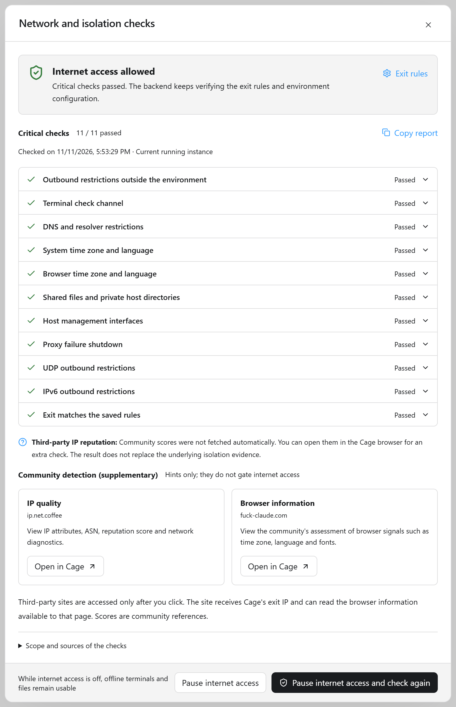
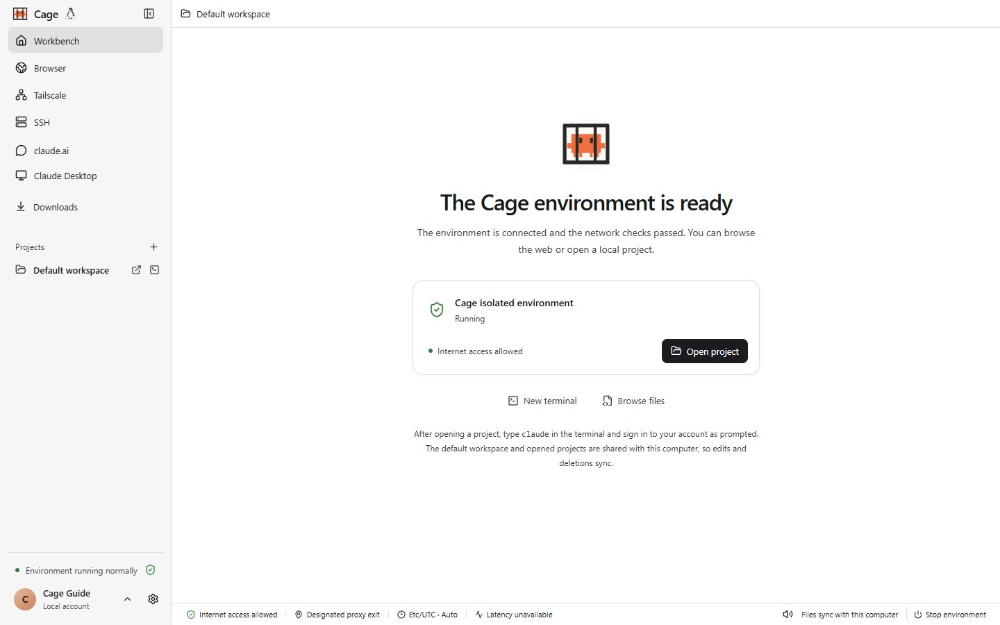

<div align="center">

<h1>Claude Cage</h1>

**Lock Miss Claude in a cage, to keep our encounters safe**


[](https://github.com/Lee-xeo/Claude-Cage/releases) [](https://github.com/Lee-xeo/Claude-Cage/actions/workflows/ci.yml) [](LICENSE)

**[Project site](https://lee-xeo.github.io/Claude-Cage/) · [Download the app](https://lee-xeo.github.io/Claude-Cage/#download) · [Documentation](https://lee-xeo.github.io/Claude-Cage/docs/) · [FAQ](https://lee-xeo.github.io/Claude-Cage/docs/troubleshooting/)**

[English](README.md) · [简体中文](README.zh-CN.md) · [繁體中文](README.zh-TW.md) · [Русский](README.ru.md) · [العربية](README.ar.md) · [فارسی](README.fa.md) · [한국어](README.ko.md) · [Español](README.es.md) · [မြန်မာဘာသာ](README.my.md) · [Беларуская](README.be.md) · [پښتو](README.ps.md) · [دری](README.prs.md) · [አማርኛ](README.am.md) · [Soomaali](README.so.md) · [ትግርኛ](README.ti.md) · [Français](README.fr.md)

</div>

## Fed up with Anthropic

As an ordinary user who just wants to talk and work with Claude, we are fed up with juggling VPSes, fingerprint browsers and environment detection, and with the constant fear of bans and financial loss. So we built **Claude Cage**: **a ready-to-use desktop app. Set up your own network proxy, and it manages isolated environments, time zone, language and environment checks in one place.**

Claude Cage lets you work with Claude in a system you already know: a macOS virtual machine on a Mac, a Windows virtual machine on Windows, or a lightweight Linux environment. The terminal, browser, editor and the official Claude Desktop live in one workbench, projects are shared only when you choose, and the network is managed separately. You can also connect your own server, or pick up a task from your computer on your phone. Key features:

- Network settings isolated from the host: Cage takes over and proxies all traffic inside the environment
- Fingerprint settings isolated from the host, including time zone and language, with automatic sync to the proxy IP
- End-to-end adaptation for using Claude (browser sign-in, authorization, the Claude Code process)
- Built-in network and isolation checks that pause internet access when a critical check fails or the evidence is incomplete; community and third-party detection sites provide extra reference

**Environment detection results with Cage:**

| Network and isolation checks | Browser environment detection (community reference) |
| :---: | :---: |
| <a href="assets/network-checks.png"></a> | <a href="assets/community-browser-check.png"></a> |

**The Cage main window:**



## What you can do with it

- **Do everything in one window.** Run Claude Code in the terminal, review changes in the editor, and use the Cage browser to preview services and sign in.
- **Develop in a familiar system.** Choose a macOS, Windows or Linux guest and use the tools of that platform. Cage can also match your computer's system version, download the official image and create a separate environment. [Choose a guest system](docs/guide/guest-systems.md)
- **Control what is shared.** Only the default workspace and project folders you open explicitly are shared; the host's Claude sign-in, browser profile and SSH keys are never imported automatically.
- **See the network state.** Built-in proxy management lets you import subscriptions, pick a node and check the exit. While a critical check fails, the environment stays offline; if the proxy is unavailable there is no direct fallback.
- **Pick up where you left off.** Tools, files and sign-in state are kept on the virtual disk, and background tasks can keep running after you close the window.
- **Manage several Claude Code subscriptions.** View usage limits, assign an account to a new session, and switch accounts to continue history once you explicitly authorize it. [Claude Code](docs/guide/accounts.md)
- **Continue tasks from your phone.** Pair an Android or iPhone with your computer to continue Claude Code conversations and approve tool calls, or operate the remote browser and Claude Desktop. [Phone connection](docs/guide/mobile.md)
- **Put the environment on your own server.** Deploy to or connect a Linux VPS over SSH; tools, tasks and data stay on the server, no KVM needed. [Cloud deployment and SSH](docs/guide/cloud.md)
- **Connect devices over a private network.** Sign in to Tailscale inside Cage, see the devices on your network, and use SSH, the web and other TCP services. [Tailscale private network](docs/guide/tailscale.md)

For browser bookmarks, incognito sessions, cookies, extensions, the password vault, and appearance, resources, storage and tool updates, see the [full documentation](https://lee-xeo.github.io/Claude-Cage/docs/).

## Quick start

Send this to your agent (Codex, DeepSeek, WorkBuddy, anything but Claude Code 😁):

```markdown
Install https://github.com/Lee-xeo/Claude-Cage for me, and set Cage's proxy to the xxx node of the Clash running on my computer.
```

All you need is a reliable proxy node. This project does not promote any proxy service; you can search for one yourself.

## Download and install

Cage supports macOS, Windows and Linux: Apple Silicon Macs on macOS 14+, Windows 10 22H2 / 11 x64, and Debian 12 / Ubuntu 22.04 / 24.04 x86_64. A Windows 11 guest needs a Hyper-V capable Windows 11 Pro, Enterprise or Education host; other supported Windows hosts can use Debian or Ubuntu 22.04. Intel Macs, Windows ARM64 and Linux ARM64 are not supported yet. [macOS](docs/getting-started.md) · [Windows](docs/windows.md) · [Linux](docs/linux.md).

1. Open the [project site](https://lee-xeo.github.io/Claude-Cage/#download), click "Download the app" and choose your platform.
2. macOS: open the installer, drag **Cage** into **Applications**, then launch it from Applications. Windows: [installation guide](docs/windows.md#install-and-get-started) · Linux: [installation guide](docs/linux.md#install-and-get-started).
3. Follow the in-app guide to set up your own proxy, start the environment and open a project.

The installer ships with the workbench and the proxy core, so you do not need to install Go, Node.js, Docker or Clash first. When you create an environment for the first time, choose the guest system and storage location, and Cage prepares the matching official system image and development tools. macOS and Windows are used under their own licenses; Cage does not provide system licenses, proxy services or Claude accounts.

The source code and installers are public; release notes and checksum files are on [GitHub Releases](https://github.com/Lee-xeo/Claude-Cage/releases). For system choice, image sources and how data is retained, see the [guest system guide](docs/guide/guest-systems.md).

Features depend on the build you use; the capabilities and verification scope of public installers are defined by the release notes.

macOS and signed Windows builds can update through the selected proxy; unsigned Windows previews and Linux are updated manually with the installer. Save your work and stop tasks before updating; personal data is kept. [Upgrade and uninstall](docs/guide/maintenance.md)

## Three steps to start

### 1. Choose a proxy

Import a Clash/Mihomo YAML subscription or a local config, pick a node and click "Apply proxy". If you need a relay, configure a chained proxy. [Network and proxy](docs/guide/network.md)

### 2. Start the environment

The first time, choose a guest system or "Match this computer's system version", then choose the storage location. Click "Install guest" or "Start Cage environment" and follow the guide to finish setup and authorization; progress and errors are in "Operation details". Later starts reuse the existing environment.

### 3. Open a project and run Claude

Click "Open project" to pick a folder on this computer, then open a new terminal, type `claude`, and complete your own account authorization in the Cage browser. You can also start with the default workspace, with no project prepared in advance. For the full steps, see [Getting started](docs/getting-started.md).

## Know these limits before you start

- Changes and deletions in a shared project directly affect the original files on this computer, including Git operations. Use version control or backups and check your commits.
- Projects in the same Cage configuration share the selected guest system, tools, account and file system; there is no isolation between projects. Changing the guest system requires a separate installation, and the data of the original environment is kept.
- By default, outbound public traffic supports IPv4 TCP, with DNS going through the same proxy; public UDP, IPv6, ICMP, and direct connections to the host and the local network are restricted. After you enable Tailscale, devices can be reached with private-network permissions.
- Network checks show the current configuration and sampled evidence. They cannot guarantee that your account will not be restricted by a platform, and they are no substitute for a full virtualization security audit.

For the detailed mechanism, see [Network and data boundaries](docs/getting-started.md#network-and-data-boundaries).

## Documentation and contributing

The user-facing [documentation site](https://lee-xeo.github.io/Claude-Cage/docs/) can be browsed by feature, searched and jumped into by section. For each operation, see the [documentation index](docs/README.md).

| What you want to do | Start here |
|---|---|
| Let your own agent download, install, configure and troubleshoot Cage | [Agent guide](https://lee-xeo.github.io/Claude-Cage/docs/agent/) |
| Install for the first time, set up a proxy, open a project | [Installation and first launch](https://lee-xeo.github.io/Claude-Cage/docs/installation/) |
| Choose a macOS, Windows, Debian or Ubuntu 22.04 guest and use native development tools | [Choose a guest system](https://lee-xeo.github.io/Claude-Cage/docs/guest-systems/) |
| Add several subscriptions, view usage limits and assign terminals | [Multiple accounts and usage limits](https://lee-xeo.github.io/Claude-Cage/docs/accounts/) |
| Scan a QR code on your phone, approve tools, use the remote browser | [Phone connection and remote sessions](https://lee-xeo.github.io/Claude-Cage/docs/mobile/) |
| Deploy and connect an environment on your own VPS | [Cloud deployment and SSH](https://lee-xeo.github.io/Claude-Cage/docs/cloud/) |
| Learn what each setting does and when it takes effect | [Settings reference](https://lee-xeo.github.io/Claude-Cage/docs/settings/) |
| Maintain storage, resources, updates and backups | [Maintenance, resources and data](https://lee-xeo.github.io/Claude-Cage/docs/maintenance/) |
| Fix download, startup, networking and sign-in problems | [Troubleshooting](https://lee-xeo.github.io/Claude-Cage/docs/troubleshooting/) |
| Learn how files, keys, and closing and quitting behave | [Projects, terminals and files](https://lee-xeo.github.io/Claude-Cage/docs/workbench/) |
| Report a reproducible problem | [GitHub Issues](https://github.com/Lee-xeo/Claude-Cage/issues) |

The project is still iterating quickly. Join the community group to share feedback, and community experts are welcome to help maintain it.

<p align="center">
  <a href="assets/community-qq.png"></a>
</p>

## Sources and license

Cage is built on [agent-vm](https://github.com/sylvinus/agent-vm).

The project is licensed under [MIT](LICENSE). Bundled components keep their own licenses, and Mihomo is distributed as a separate executable under GPL-3.0; see also [NOTICE](NOTICE) · [Third-party licenses](THIRD_PARTY_LICENSES) · [noVNC](ui/vendor/novnc/LICENSE.txt).

Cage is an independent community project and is not affiliated with Anthropic.

## References and thanks

Thanks to these projects for providing the foundation or design reference for Cage:

- [agent-vm](https://github.com/sylvinus/agent-vm): the base Cage is built on.
- [Lima](https://github.com/lima-vm/lima): virtual machine management and the runtime foundation for macOS and Linux guests.
- [gvisor-tap-vsock](https://github.com/containers/gvisor-tap-vsock): virtual machine networking.
- [sshocker](https://github.com/lima-vm/sshocker) and [SFTP](https://github.com/pkg/sftp): file sharing between the virtual machine and the host.
- [noVNC](https://github.com/novnc/noVNC): remote display and interaction in the browser.
- [Mihomo](https://github.com/MetaCubeX/mihomo): the built-in proxy core.
- [code-server](https://github.com/coder/code-server): the code editor in the browser.
- [AIO Sandbox](https://github.com/agent-infra/sandbox): reference for the working environment and interaction design.
- [claude-switcher](https://github.com/YOURSJEYO/claude-switcher) and [Claude-Guardian](https://github.com/DUNHKpcc/Claude-Guardian): reference for network checks and security diagnostics.

<a href="https://www.star-history.com/?repos=Lee-xeo%2FClaude-Cage&amp;type=date">
  <picture>
    <source media="(prefers-color-scheme: dark)" srcset="https://api.star-history.com/svg?repos=Lee-xeo/Claude-Cage&amp;type=Date&amp;theme=dark" />
    <source media="(prefers-color-scheme: light)" srcset="https://api.star-history.com/svg?repos=Lee-xeo/Claude-Cage&amp;type=Date" />
    
  </picture>
</a>
