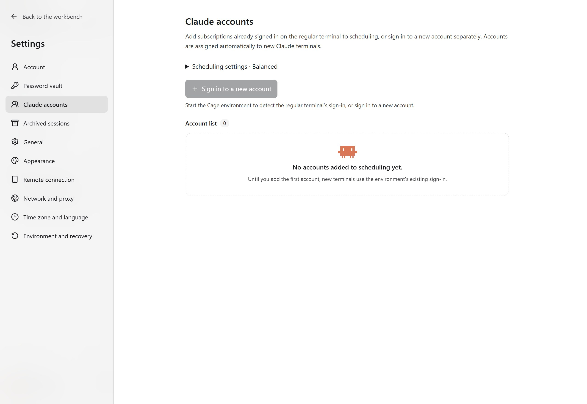

## Tell apart three kinds of accounts

| Account or sign-in | Purpose and ownership |
| --- | --- |
| Cage account | Unlocks the Cage workbench on this host. |
| Claude Code account | Lets terminals in the environment use a Claude subscription after authorization. Managed and scheduled under "Settings → Claude accounts". |
| Web and Claude Desktop sign-ins | Each keeps its own sign-in state and is not added to Claude Code scheduling automatically. |

Start the environment first, wait for the tools to be ready, then open the accounts panel. Account features depend on the build you are using. If the panel is missing, check the version first.

<figure class="guide-shot">
  
  <figcaption>Claude accounts panel with the environment not started and no accounts registered. Screenshot version: 0.1.7-rc.1 (development build) · UI test stand on Windows 11 x64 · 2026-11-11. <a href="../../www/public/docs/screenshots/claude-accounts.jpg" target="_blank" rel="noopener">View original (2560 × 1764) ↗</a></figcaption>
</figure>

## Add an existing sign-in to scheduling

In a regular terminal in Cage, run `claude auth login`. If the terminal shows an official Claude authorization link, click it to continue in a temporary tab of the Cage browser. Follow the prompts on the page, then return to the original terminal to confirm the sign-in result.

After a successful sign-in, the accounts panel shows the email detected by the default terminal. Check it, then click "Add to scheduling". This only reads the sign-in inside the Cage environment, not accounts in the host system's terminal.

If the regular terminal was first signed in as A and later signed in as B, Cage stops assigning the default directory to A. B must be added separately. To keep A and B both available long term, keep one default sign-in and add the other account through a separate sign-in.

## Add another subscription

1. In "Settings → Claude accounts", click "Sign in to a new account".
2. Complete the official sign-in by following the prompts in the sign-in terminal and the temporary authorization browser that open. Each separate sign-in uses its own configuration directory.
3. After success, the account is registered by email. You can edit its note and check that "Include in automatic assignment" is turned on.
4. Click the terminal icon next to a project to open a new Claude terminal, then check which account the tab shows.

Cancelling a sign-in does not add an account to scheduling. The same subscription is not added to scheduling twice. If a separate account needs to sign in again, close the terminals still using it first, then follow the panel's prompts.

## When automatic assignment happens

Automatic assignment happens when you open a new Claude terminal. In "Scheduling settings", choose:

- **Balanced assignment**: considers the number of terminals in use and known remaining usage. It rotates when conditions are similar and favors accounts recently used by the same project.
- **List order first**: uses the first available account in the list. Accounts further down are used only when their usage is exhausted, their sign-in has expired or assignment is paused. Adjust the order with "Move up".

Turning off "Include in automatic assignment" for an account only affects terminals opened later. Tasks already using that account can continue. Changing the scheduling mode does not change the account bindings of existing sessions.

## Share skills, instructions and memory

Sign-in credentials are separate for each account, while the Cage session list shows history together. Project files and the instructions and skills in a project are shared directly. User-level local skills, instructions, rules and agent definitions share the material inside the environment, and automatic memory for the same project uses the same location. You can keep using this material after changing accounts. Personal settings from the host system are not imported automatically.

Skills downloaded from a Claude.ai account or organization still belong to the original account. Sign-in identity, credentials, account remote settings and MCP account authorization are not merged automatically. If existing material has the same name but different content, Cage keeps the original file and asks you to check it first, to avoid overwriting user material.

## Switch accounts within the same session

First fill in "Handoff group" on the account card, and put the accounts that may receive the same session history into the same group. Accounts without a group do not resume across accounts. Do not mix work and personal material in the same group carelessly. The group controls where automatic handoff goes, and it is not filesystem security isolation.

The account button above the computer's terminal and in phone sessions shows the current binding. Expand it to choose:

- **Ask each time**: you choose the target account, tick to allow handing over history, then run "Switch and restore history".
- **Resume automatically when usage runs out**: when the official CLI reports rate limiting and the usage reading confirms the window is used up, it tries to resume on an available account in the same group.
- **Always wait for the original account**: automatic resume stays off, but you can still start one explicit, confirmed switch manually.

The authorization in account settings only affects new sessions by default, and you can change it separately within a session. Resuming keeps the same Cage session entry. The target account runs a new official CLI process and restores the history, and the original history is kept. Manual switching only restores history by default. To keep executing, tick "Continue the unfinished task after restoring". Server-side prompt caches across accounts may need to be rebuilt, so the first turn may be slower.

The original executor must stop before handing over. Running tools, unprocessed messages, tool approvals, background tasks or tools with unknown results block the switch. End them or check them as prompted, then retry. If the handover fails, you can retry the original operation. During preparation you can also cancel and keep the original account. Cage does not resubmit old messages or completed tools to restore, but the model may still decide to call tools again, so check the task results as you continue.

This feature runs the official Claude Code inside the guest and does not extract subscription tokens to proxy model requests. The current code supports the Linux, macOS and Windows guest paths. Native guests must use matching environment components, and Windows also requires signing in to and unlocking the bound guest desktop.

Cross-account restore, shared material and authorization checks have been verified with an isolated official CLI, using synthetic accounts and local model responses. Real dual-subscription server compatibility, full sign-in and handover on native guests, and the vendor's specific permission for automatic rotation still need to be confirmed. If the CLI version or organization policy does not support Channels, phone resume is also limited. Stale usage readings, service overload or unknown errors are not treated as confirmed usage exhaustion.

## View five-hour and seven-day usage

Opening the panel queries the official Claude Code inside the environment for five-hour and seven-day usage and reset times. The "Check status" button on a card refreshes immediately, without sending a model message first.

When a usage window returns no reading, the interface says so and keeps that window's last percentage and read time. An old reading should not be treated as live available usage, nor as a guarantee that the service will accept the next request.

## When no account is available

Check in this order: whether the account signed in successfully, whether "Include in automatic assignment" is on, whether known usage has been reached, and whether the expected reset time has passed. Click "Check status" first. If the identity has expired, sign in again as prompted.

If you switched accounts in a regular terminal, check whether the new identity was added to scheduling separately. For official authorization or request failures, see [Claude sign-in and account errors](troubleshooting.md#claude-sign-in-and-account-problems).
