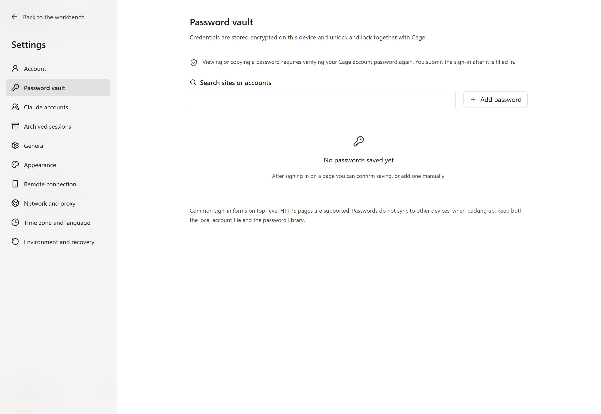

## Open web pages and browser settings

Click "Browser" in the sidebar, enter a site in the address bar, and use the plus button at the top to open a new page. The `claude.ai` entry opens the Claude website directly. `localhost` refers to the current Cage guest, so start preview servers from the Cage terminal.

The browser menu to the right of the address bar offers settings, incognito and site data. The browser settings page can be searched for "New tab", "Appearance", "Privacy and site data", "Extensions" and "About browser". The default new-tab address applies to tabs you open later. The horizontal or vertical tab layout takes effect immediately and is saved in the current client.

Closing the browser view only returns you to the previous workspace, and pages and sign-ins stay open. To end an incognito session, close all incognito tabs or stop the environment.

On Linux environments, after the last browser view window leaves, the browser window is minimized so that background pages use Chromium's throttling. When you return to the browser, the original window and unsaved input are restored. When several workbenches view it at once, windows still being viewed keep displaying. Mobile browsers have their own sessions.

On Linux environments, the refresh rate of the browser and Claude Desktop adjusts to how you use them. It stays at 60 Hz while you use the keyboard or mouse or resize the window. It drops to 30 Hz about 3 seconds after you stop, and to 20 Hz after about 3 minutes of inactivity. It returns to full rate as soon as you act again. Resolution, font size and sharpness stay the same. Web animations and videos play at a lower frame rate when nobody is interacting. This feature is enabled by environment component updates and requires `python3-xlib` in the environment. Environments with Claude Desktop installed get it immediately. Environments that only use the browser get it after the next environment tools update.

On Linux environments, the browser and Claude Desktop render at the density of the screen that shows them. On a 2x high-DPI screen, each pixel of the picture maps to one screen pixel. On a regular screen at 100% scaling, only a quarter of the pixels are rendered, and text is equally pixel-sharp. When you move the window to another screen or change system scaling, the picture redraws at the new density, while font size and visible content stay the same. Screens above 2x render at 2x.

New setups turn on "Settings → General → Prefer smoothness" by default. On high-DPI screens it renders at three quarters of the screen pixels, which cuts the pixel count on a 2x screen by about 44%. Regular screens already use the fewest pixels, so they do not change. Turn it off if you need finer detail. The setting takes effect the next time you start the environment. Existing setups keep their original quality.

Rendering at the screen's density is enabled by environment component updates and requires `xsettingsd` in the environment. Environments with Claude Desktop installed get it immediately. Environments that only use the browser get it after the next environment tools update. Until then, and on Windows guests, the picture keeps rendering at a fixed 1.5x or 2x.

In macOS and Windows guests, the browser scrolls by the actual distance of the wheel or trackpad. While you scroll, the picture updates at up to 60 Hz. About 1 second after you stop, it returns to 30 Hz, and when still, it slows frame updates further. This behavior takes effect after the guest components are updated. Older components keep scrolling in fixed steps.

The download button to the right of the address bar opens a file list in the upper-right corner. From there you can see download progress, save as, open files or show them in the folder. If a save fails, you can retry. Long lists scroll inside the panel. Click outside it or press Esc to close it. The "Downloads" item in the sidebar also opens this panel.

Under "Privacy and site data" in the browser settings, you can also find "Site permissions" and "Clear browsing data", which open the matching Chromium pages. Decide on permissions such as camera and microphone based on the devices the environment actually has. "Search engine" and "Download settings" under "About browser" open more native browser options. Seeing these options does not mean Cage has connected every device capability.

## Bookmarks and tabs

Click the star in the address bar, or press `⌘D` on a Mac, to bookmark the current page. Edit its name and choose or create a folder. The bookmarks button or `⌘⇧O` opens management, where you can search, open, rename and move bookmarks. On Windows and Linux, use Ctrl instead.

Deleting a folder moves its pages to "Uncategorized". Bookmarks belong to the current Cage configuration and are shared by all projects, so switching projects does not remove them.

Right-click a tab or press Shift+F10 to open its action menu, and drag tabs to change their order. When the list is long, you can search open pages. Pinned tabs are sorted within their own group.

## Use incognito sessions

Choose "New incognito tab" from the menu, or press `⌘⇧N` on a Mac or `Ctrl+Shift+N` on Windows and Linux. Incognito tabs and the address bar are clearly marked. The plus button on an incognito page keeps opening incognito tabs. To open a regular page, choose it from the menu.

Cookies, sign-ins and site storage for regular and incognito sessions are kept separate. All incognito tabs from the same batch share one temporary session. Closing the last incognito page clears that session, and restarting does not restore those tabs. Incognito never offers to save passwords, but bookmarks and downloads you save on purpose are kept.

Incognito sessions still use the same proxy exit, so websites and the proxy service can still see requests. Hiding a window does not end a background incognito process.

## View and clear cookies

Open "Manage cookies" from the browser menu to view cookies for the current site or all sites. Search by site or name. You can view values, delete a single cookie, or clear all cookies for the current site or the current session.

Clearing only affects the regular or incognito session that the current tab belongs to. **A search filter does not narrow what gets cleared.** Check the site and session before you confirm. You may need to sign in again after clearing. Clearing cookies does not also delete the site's localStorage.

Clearing all cookies in the regular session also clears the file editor's authentication. Use "Restore editor" in the editor menu to get back in.

## Install or import extensions

In the browser settings under "Extensions", import a Manifest V3 ZIP. Each package is limited to 32 MB. Read the permissions the interface lists before you confirm the install. Install only from trusted sources, since an extension can read the web page content it is allowed to access.

The desktop app can copy extensions and their on/off state from Edge, Chrome, Brave or Chromium on this computer. Importing does not copy browser accounts, cookies or an extension's own sign-in data. Some extensions whose IDs change need to be set up again. Extensions run in the Cage browser, so your local browser's environment and network do not move with them.

If an older environment lacks the entry point or shows an error about installation components, update the app and environment components first, then reopen the browser.

<figure class="guide-shot">
  
  <figcaption>Password vault management entry. Screenshot version: 0.1.6-alpha-preview (development build) · macOS native app · 2026-11-07. <a href="../../www/public/docs/screenshots/password-vault.jpg" target="_blank" rel="noopener">View original (2560 × 1764) ↗</a></figcaption>
</figure>

## Save website passwords

After you finish signing in to a website, choose "Save password" or "Update password" in the tools area. On your next visit, expand "Password", pick an account to fill in, and then submit the sign-in yourself.

"Settings → Password vault" lets you search, add manually, edit, delete and restore website prompts. To view or copy a password, you must enter your Cage password again. For supported scopes and backup requirements, see [Settings reference](settings.md#password-vault).
