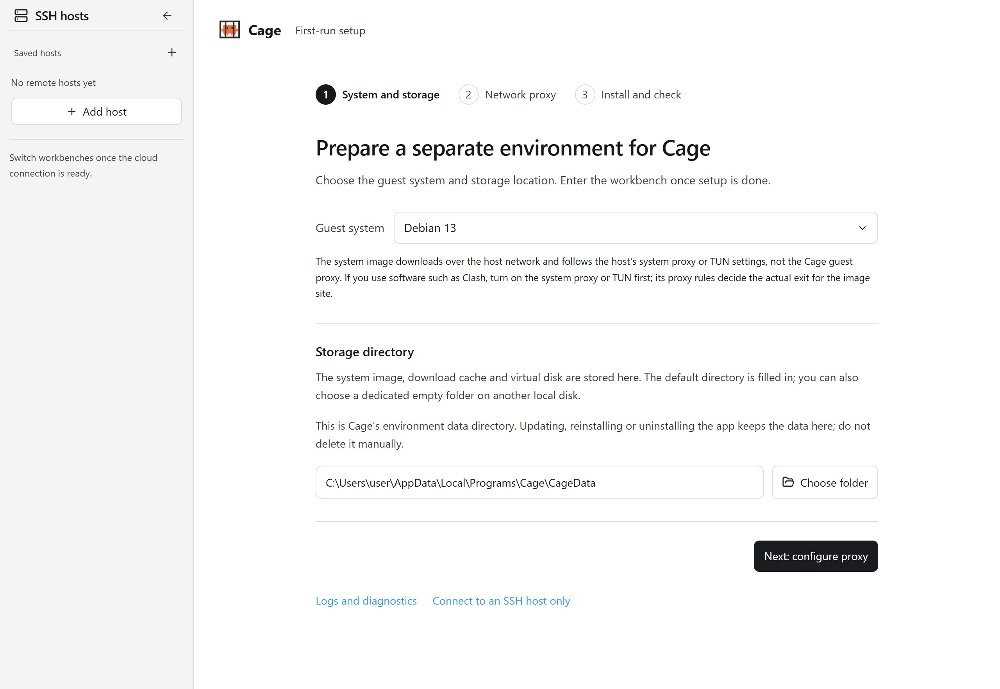
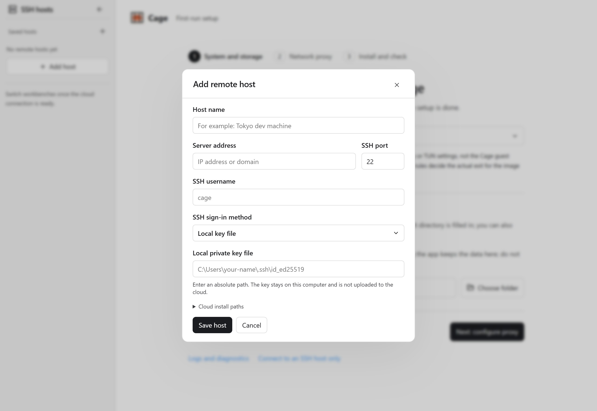
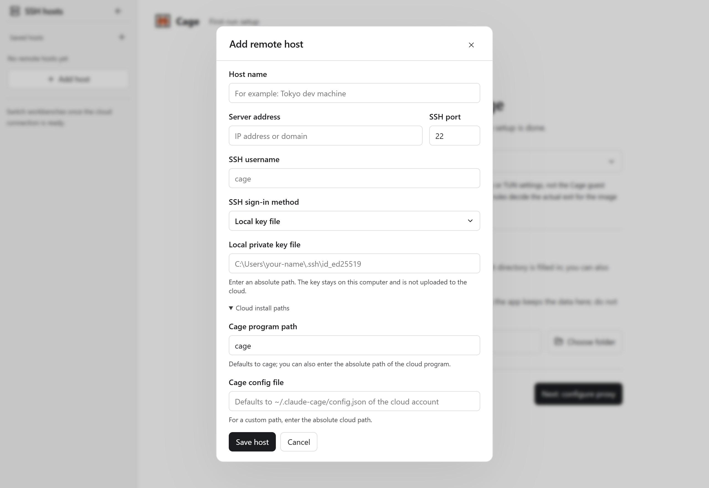

## When to choose cloud

Use cloud mode when you want tasks to keep running on a server, or when this computer is not suited to running virtual machines. The terminal, browser, editor, Claude Desktop and network exit live on the server, and your computer shows the same workbench. The local virtual machine can stay off.

Server mode runs in rootless containers and does not require KVM. It still has to meet system, permission and resource requirements, and not every VPS can be deployed directly.

Cloud uses a Linux environment, separate from the local choice of macOS, Windows or Debian. When you need native Mac or Windows tools, use the matching local guest. When you need tasks to run on a server all the time, choose cloud. Both approaches use the same workbench. See [Choose a guest system](guest-systems.md).

## Prepare the server

The current target is Linux x86_64. It needs a systemd user service, cgroup v2, rootless user namespaces, at least 65,536 subordinate UIDs/GIDs, and `/dev/fuse` and `/dev/net/tun`. The regular SSH user needs the matching permissions. You also need basic tools such as OpenSSH, curl, tar, sha256sum, iproute2 and iptables.

For the full prerequisites and maintenance commands, see the [deployment guide](https://github.com/Lee-xeo/Claude-Cage/blob/main/deploy/cloud/README.md). If a permission is missing, fix the server configuration instead of switching to a privileged container or exposing the Docker socket to the working environment.

If tasks must keep running after you leave SSH, or services must recover after a server reboot, have the server administrator configure the systemd user service, linger and the matching startup policy.

<figure class="guide-shot">
  
  <figcaption>SSH hosts sidebar with your own server added. Screenshot version: 0.1.7-rc.1 (development build) · Windows 11 x64 native app · 2026-11-11. <a href="../../www/public/docs/screenshots/ssh-sidebar.jpg" target="_blank" rel="noopener">View original (2560 × 1764) ↗</a></figcaption>
</figure>

## Deploy and connect from the sidebar

1. Open Cage, go to "SSH hosts" in the left column, and click the plus button. Fill in the name, address, port, username, and local key file or SSH agent. To use a custom path, set it under "Cloud install path".
2. Click "Connect to this host" and compare the SSH host fingerprint with the record the server shows separately. If the fingerprint has changed, find out why before you continue.
3. On first use with an empty configuration directory, click "Deploy and connect". Cage transfers the matching program and scripts, and sets up an independent engine and persistent environment on the server.
4. If it is already deployed and ready, you go straight in. If a user service that Cage can confirm it owns is stopped, Cage tries to start it. After an interrupted install, retry with the same version.
5. Once the cloud workbench opens, create or unlock the server's own Cage account, then set up the server's proxy and projects.

If tasks are running locally, the connection card offers options to keep or stop the local environment. Save your content before you stop it. Do not deploy a cloud instance for the first time onto an existing local data directory that has no backup.

<figure class="guide-shot">
  
  <figcaption>Remote host address, authentication and private key path form. Screenshot version: 0.1.7-rc.1 (development build) · Windows 11 x64 native app · 2026-11-11. <a href="../../www/public/docs/screenshots/ssh-host-form.jpg" target="_blank" rel="noopener">View original (2560 × 1764) ↗</a></figcaption>
</figure>

## Server projects and local sharing

The remote workbench lets you choose a server directory. Cloud accounts, browsing data, the vault, nodes and system language belong to that server, and existing local configuration is not copied over automatically. Before you act, check which host name is currently active.

To use local source code, authorize one specific project in the interface and choose read-only or read-write access. Sharing is valid only while the authorized connection lasts. The Git directory and history are shared with the project: read-only sharing allows viewing, and read-write sharing allows staging, committing and switching branches. Hidden files, credentials and tool configuration inside the authorized directory are also shared, while access outside the directory is still denied. Read-write sharing modifies local source files and the repository directly, so back up first and review your changes.

Uploads are read from the files you select with the local picker. Downloads are provided by the server, and then explicitly saved to this computer. The save locations for remote files and local copies are shown separately.

## Disconnect, lock and stop

Closing the local window or disconnecting SSH releases the client connection, while the server environment and tasks keep running. Reconnecting reads the sessions that are still alive. To end remote tasks, click "Stop environment" in the matching cloud workbench.

After you switch hosts, file selections, input and requests from the old connection cannot reach the new host. A failed connection never falls back to operating this computer. For operations whose result is unclear, such as sending or saving, check the status after reconnecting before you retry.

<figure class="guide-shot">
  
  <figcaption>Programs and configuration paths on a custom server. Screenshot version: 0.1.7-rc.1 (development build) · Windows 11 x64 native app · 2026-11-11. <a href="../../www/public/docs/screenshots/ssh-install-paths.jpg" target="_blank" rel="noopener">View original (2560 × 1764) ↗</a></figcaption>
</figure>

## Updates and recovery

Client updates only update the local program, and server maintenance is done separately. Before you update the server, save your tasks and stop the related environments and services. Keep the configuration, projects, container file system and engine data intact, and restore them using the original absolute paths.

Do not delete containers or run commands that clear all engine data to upgrade. The container's writable file system also holds persistent data. If you see a connection, fingerprint or deployment prerequisite error, see [SSH and cloud failures](troubleshooting.md#ssh-or-cloud-deployment-failure).
