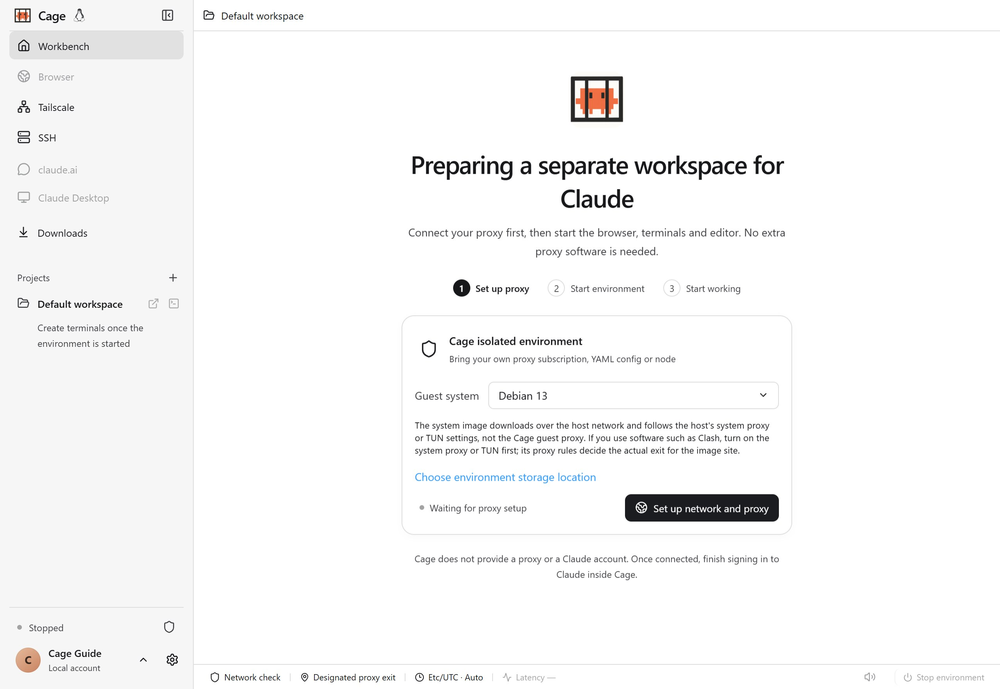

Cage puts the terminal, browser, editor and the official Claude Desktop in one workbench. Mac users can use native tools in a macOS guest, Windows users can build and run projects in a Windows guest, or choose the lightweight Debian environment. Projects are shared on demand, networking is managed separately, and tools and sign-in data stay with each environment.

You can work on your own computer, or connect to your own Linux server over SSH. When you step away, use your phone to pick up the same Claude Code session, handle tool approvals, or operate the browser and Claude Desktop on your computer.

This guide describes the features of the current development build. Whether a public installer includes each entry point, and the testing scope for each platform, is defined in the matching release notes. When you create a new environment, you can choose "Match this computer's system version automatically" to build a clean guest from official materials. For requirements and current test coverage, see [Choose a guest system](guest-systems.md).

Screenshots come from the actual app and an isolated test environment. Each image is labeled below with its version, platform and date; click an image to see the original resolution. The main desktop images use the `0.1.6-alpha-preview` development build. Older Windows builds and phone simulator previews are noted separately. Empty accounts, stopped states and sample conversations in the UI are kept as they are. They do not mean that you are signed in or that a real model request succeeded.

<figure class="guide-shot">
  
  <figcaption>First-run guide in the Cage workbench. Screenshot version: 0.1.6-alpha-preview (development build) · macOS native app · 2026-11-07. <a href="../../www/public/docs/screenshots/first-start.jpg" target="_blank" rel="noopener">View original (2560 × 1764) ↗</a></figcaption>
</figure>

## First use

1. Read [Installation and first launch](installation.md) and install the Cage build that fits your computer. Then set up a macOS, Windows or Debian environment following [Choose a guest system](guest-systems.md).
2. In [Network and proxy](network.md), import your own nodes, apply the proxy, then start the environment and wait for the critical checks to pass.
3. Open a project following [Projects, terminal and files](workbench.md), complete Claude Code authorization inside Cage, and send your first message.
4. If you have several Claude subscriptions, set up [Multiple accounts and usage limits](accounts.md). To keep working away from your computer, see [Phone connection and remote sessions](mobile.md).

## Find by task

| What you want to do | Read this |
| --- | --- |
| Have your own agent install, configure and troubleshoot Cage | [Let an agent configure Cage](agent.md) |
| Install the app, change disks, prepare local virtualization | [Installation and first launch](installation.md) |
| Use the same kind of system as your host, choose native dev tools | [Choose a guest system](guest-systems.md) |
| Import subscriptions, connect a residential proxy, set exit rules | [Network and proxy](network.md) |
| Open projects, start a Claude terminal, transfer files and screenshots | [Projects, terminal and files](workbench.md) |
| Add several subscriptions, check usage limits, assign or resume sessions | [Multiple accounts and usage limits](accounts.md) |
| Bookmark pages, browse incognito, clear cookies, install extensions | [Browser and site data](browser.md) |
| Use Claude Desktop inside Cage | [Claude Desktop](desktop.md) |
| Pair a phone by QR code, approve tools, use the remote browser on your phone | [Phone connection and remote sessions](mobile.md) |
| Deploy to a VPS without KVM, connect to servers and manage remote projects | [Cloud deployment and SSH](cloud.md) |
| Sign in to a private network in Cage, use SSH both ways between this computer and the guest | [Tailscale and private-network SSH](tailscale.md) |
| Find each setting and see when changes take effect | [Settings reference](settings.md) |
| Change the storage disk, adjust CPU and memory, upgrade, back up or uninstall | [Maintenance, resources and data](maintenance.md) |
| Recover from an error, export diagnostics | [Troubleshooting](troubleshooting.md) |

## How local, cloud and phone work together

In local mode, the macOS, Windows or Debian virtual machine you choose runs on your computer. Which systems you can choose depends on the host platform and its virtualization support. Host projects you explicitly open are shared with the environment, and changes apply directly to the original files.

In cloud mode, the terminal, web pages, tools, accounts and network settings belong to the server you chose. The desktop app handles the connection and display. Local projects are shared temporarily only after you explicitly authorize it. Disconnecting SSH keeps remote tasks running; only stopping the remote environment ends them.

The phone is a remote client, and commands run on the paired computer. That computer must be online and running Cage. The current phone pairing points to the local Cage and does not switch to the cloud automatically when you change the SSH target in the desktop app. The phone has no mode that runs a Cage virtual machine on its own.

## Data and network boundaries

- Programs in the environment can read and modify open projects. Back up important files first. The project's `.git` is readable and writable, so you can review, stage and commit code inside Cage.
- All projects in the same environment share the guest system, tools, accounts and file system. Switching projects does not stop running tasks or revoke shares you have already authorized.
- Cage needs your own proxy and your own eligibility to use Claude. Passing the network checks means the current configuration and sampled evidence pass. It cannot guarantee that a third-party account will not be restricted.
- By default, outbound public traffic supports IPv4 TCP, and DNS goes through the same proxy. Public UDP, IPv6, ICMP, and direct connections from the environment to the host or the LAN are restricted. After you enable Tailscale, authorized private-network devices can connect through a separate channel.
- Closing the window, locking Cage, stopping the environment and signing out of an account each have different effects. Check [Closing, locking and signing out](workbench.md#close-lock-and-sign-out) before you act.
