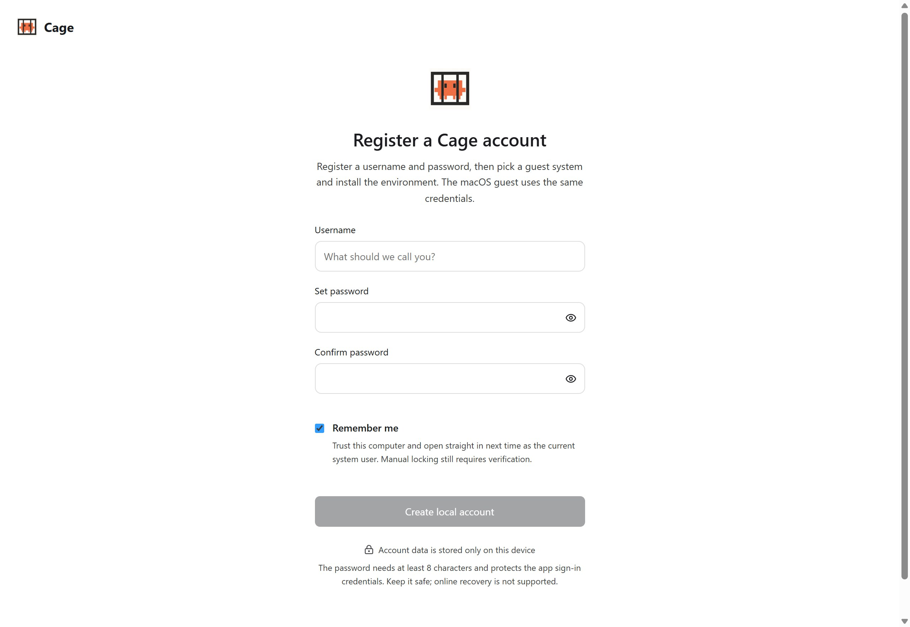
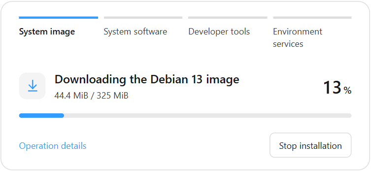

## Choose an installer

Choose your platform in the [download section of the website](https://lee-xeo.github.io/Claude-Cage/#download). For public attachments, signatures and checksum files, [GitHub Releases](https://github.com/Lee-xeo/Claude-Cage/releases) is the reference. Source archives are for development and cannot be installed directly.

| Platform | Requirements and install method |
| --- | --- |
| macOS | Apple Silicon, macOS 14+. Open the `.dmg`, drag Cage into "Applications", then launch it from there. Intel Macs are not supported yet. |
| Windows | Windows 10 22H2 / 11, x64. Run the `.exe` installer, prepare the Hyper-V or Windows hypervisor platform for the guest you choose, and restart if the system requires it. Unsigned preview packages are clearly labeled. |
| Linux | Debian 12 / Ubuntu 22.04 / 24.04, x86_64. Requires KVM and access for the current user. Run `sudo apt install ./Cage-<version>-linux-amd64.deb` to install the app dependencies, then open it from the application menu. |

Windows ARM64 and Linux ARM64 are not supported yet. For platform dependency details, see the [Windows guide](https://github.com/Lee-xeo/Claude-Cage/blob/main/docs/windows.md) and the [Linux guide](https://github.com/Lee-xeo/Claude-Cage/blob/main/docs/linux.md).

The platform selected here is the host that runs Cage. The guest system inside the virtual machine is chosen when you first create an environment. Apple-silicon Macs can use macOS or Debian. Windows 11 Pro, Enterprise and Education with full Hyper-V can use Windows 11 or Debian. Linux hosts can choose a system from the same distribution or Debian 13. For the supported combinations, see [Choose a guest system](guest-systems.md). Cage's macOS 14+ runtime requirement and the system clone conditions are judged separately. The current Mac clone entry requires macOS 26.4+.

<figure class="guide-shot">
  
  <figcaption>First-time Cage account creation. Screenshot version: 0.1.6-alpha-preview (development build) · macOS native app · 2026-11-07. <a href="../../www/public/docs/screenshots/account-setup.jpg" target="_blank" rel="noopener">View original (2560 × 1764) ↗</a></figcaption>
</figure>

## Create a Cage account

If you choose username and password sign-in, set a username and a password of at least 8 characters. This account unlocks the current Cage. Your Claude subscription must be signed in separately inside the environment. Online password recovery is not available, so keep your password safe.

Newer desktop builds that include trusted local sign-in can also offer "Trust this computer and continue". You can also choose "Use username and password" to follow the flow shown below. Existing password accounts keep their current sign-in method. For the scope of local trust, see [Trusted local sign-in](https://github.com/Lee-xeo/Claude-Cage/blob/main/docs/getting-started.md#trusted-local-sign-in).

The full desktop version ticks "Remember me" by default when you create a password account, and you can untick it. For existing accounts, adjust it on the sign-in page or in "Settings → Account". On macOS you can also turn on Touch ID. After a manual lock you still need to verify, and signing out of the account revokes the quick sign-in authorization. The account password does not encrypt the whole project directory or virtual disk.

If you had an account before and the create page appears again, stop and check [Data directory issues](troubleshooting.md#original-account-and-data-seem-to-be-gone).

## Initialize the system and storage

After your first sign-in, Cage shows a separate initialization screen. First choose the guest system that suits your projects: "Match this computer's system version automatically" or a specific system. Automatic matching shows the matching official image in the next step and installs a clean, separate system. Your personal host files and sign-in data are not copied. Later launches keep the original system and disk, and updating Cage does not replace the guest system.

The "Storage directory" field is already filled in with the default location. To change it, edit it directly or click "Choose folder" to select an empty dedicated folder on a local disk. The path is saved when you click "Next: Configure proxy". If the directory is invalid, you stay on this page with a prompt to fix it. In the Windows installer, the program directory and the environment data directory are separate. For example, the app can be on drive C while the environment goes in `D:\CageData`.

On Mac and Linux with the default configuration, environment data is stored in `.claude-cage/state` under your home directory. On the official Windows installer, the first initialization fills in `CageData` under the install directory by default. For example, if the app is installed in `D:\Cage`, environment data goes in `D:\Cage\CageData`. If there is no write permission, choose another local folder you can write to in the current field. Existing environments keep their original storage location and are not migrated automatically. Accounts and configuration are still stored in `.claude-cage` under the user directory.

The initialization page shows the full local path. System images, the later image download cache and the persistent virtual disk all use the same storage location. Files that older versions left in the system cache directory are not moved or deleted automatically. Updating, reinstalling and uninstalling the app keep the environment data directory, so after reinstalling you can continue with the existing data. Do not delete this directory by hand.

Choose a disk that supports permission management and sparse files: NTFS on Windows, ext4, XFS or Btrfs on Linux, and APFS with ownership enabled on macOS. Do not choose a disk root, a network drive, an existing project or the app's install directory. To move an existing environment to another disk, follow [Storage migration](maintenance.md#move-the-environment-to-another-disk).

## Import a proxy and start

1. Click "Next: Configure proxy", then add a Clash/Mihomo YAML subscription, a local configuration, or a manual HTTP/SOCKS5 node. For detailed steps, see [Network and proxy](network.md).
2. Choose the final exit and click "Apply proxy". Cage uses its own core and does not automatically adopt the node currently selected in your local Clash.
3. Check the matching system image, download size and space requirements, then click "Start installation". To enable Git protection, read its impact on the initialization screen, confirm, then continue the installation.
4. Stay on the initialization screen to watch the download, verification, system install and tool configuration progress. After a macOS guest is installed, it signs in automatically and opens each permission page that needs your confirmation. Turn on the matching switch as the screen describes. The "File system extension" button opens the correct panel directly. After system permissions pass, confirm workspace access. If folder authorization is needed, the initialization page provides the authorization window directly. After verification, continue to the network check. On failure, retry following the hint for the current step. "Operation details" shows the specific error and check results, and the full record can be exported under "Logs and diagnostics". An environment that has already finished the system install does not need to be downloaded or installed again.
5. Once the guest is usable and the network and isolation checks pass, click "Enter the workbench". From then on, opening Cage goes straight into the existing workbench, and when the environment is stopped you can start it directly. If you only need to connect to a remote server, the "Connect to an SSH host only" option on the initialization screen skips the local install.

Git protection changes the global `safe.bareRepository=explicit` for the current host user, which affects other Git tools on this computer. Ordinary `.git` project operations are unchanged, and bare repositories need an explicit path. The setting is written only after you confirm.

## What to expect during first launch

The first installation depends on the guest system. The clone entry first reuses verified matching material and downloads the official image if it is missing. macOS uses Apple IPSW. Windows clones use the matching Microsoft ESD, and manual installs can use an official ISO. Linux clones use the cloud image of the matching distribution. The Debian 13 base image is about 320–325 MiB, and development tools are installed separately. For image sources, system licenses and storage requirements, see the [guest system guide](guest-systems.md#download-size-and-disk-space).

System images, the image version catalog, and the macOS app and development toolkit prepared on the host are downloaded through the host network and follow the host proxy settings. If no proxy is configured, they connect directly to official sources. When using Clash and similar software, you can turn on its system proxy or TUN. The actual exit is decided by that software's rules for the download sites. If the selected host proxy connection fails, or an explicitly configured PAC fails to resolve, the download reports an error and does not fall back to a direct connection automatically. Processes and downloads inside the guest use Cage's own proxy. For the choice of official sources and fallback images, and platform settings, see [Image download network](network.md#download-network-for-system-images).

The Debian initial virtual disk is capped at 24 GiB, while macOS and Windows need more space for the system and development tools. Actual usage grows with installation and use, so check the requirements of the version you selected before you create it. Claude Desktop is downloaded separately as needed. Later launches reuse tools, files and sign-in data.

If a download is interrupted, check the error, fix the network or disk space, then click "Continue installation". The macOS app and development toolkit, which have a fixed SHA-256 digest, try to resume. After all data is received, the whole file is verified. If the digest does not match or the server does not support resuming, that file is downloaded again from the start. Chrome uses a download address that changes with each version, so after an interruption the whole installer is downloaded again. Do not fix install failures by emptying `.claude-cage` or rebuilding the account.

During download, the app shows received bytes, the total available and sampled speed. Verification shows its processing progress separately. System recovery and tool installation without a measurable total show the stage instead. Continuing the installation keeps the original installation identity, system choice and created disk.

<figure class="guide-shot">
  
  <figcaption>First image download progress in the Windows native app. Screenshot version: 0.1.5-alpha.2 (test build) · Windows 11 x64 native app · 2026-11-06. <a href="../../www/public/docs/screenshots/windows-native-download.png" target="_blank" rel="noopener">View original (750 × 320) ↗</a></figcaption>
</figure>

## Do your first task

Click the plus next to a project to open your own directory, then complete the authorization inside the environment with "New Claude terminal". First let Claude read a file or make a small edit, and check the result on the host before you start a real task. For files, terminal and uploads, see [Projects, terminal and files](workbench.md).
