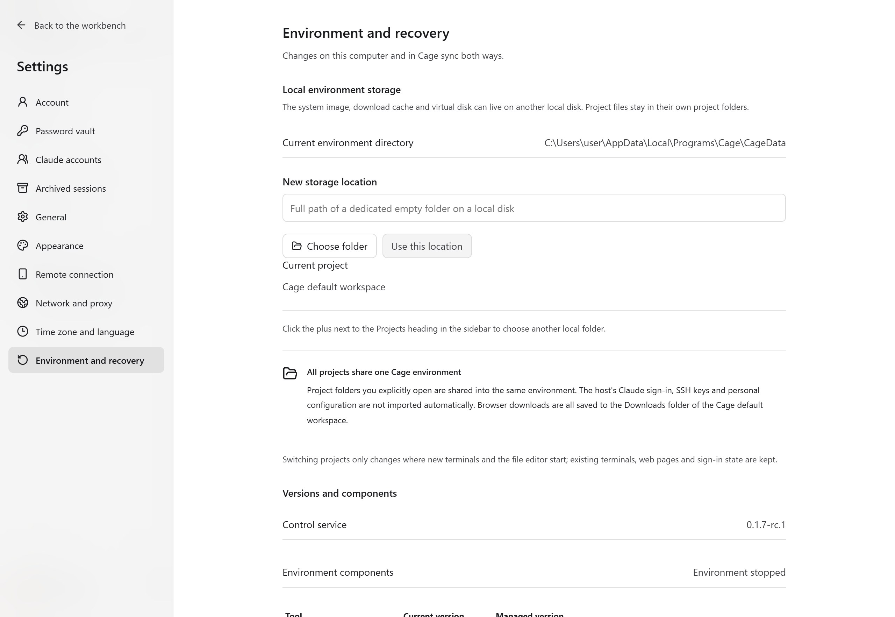
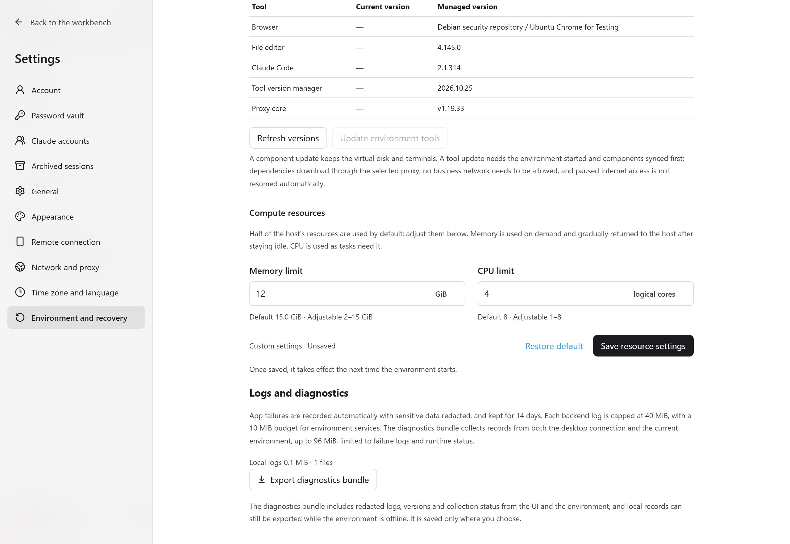
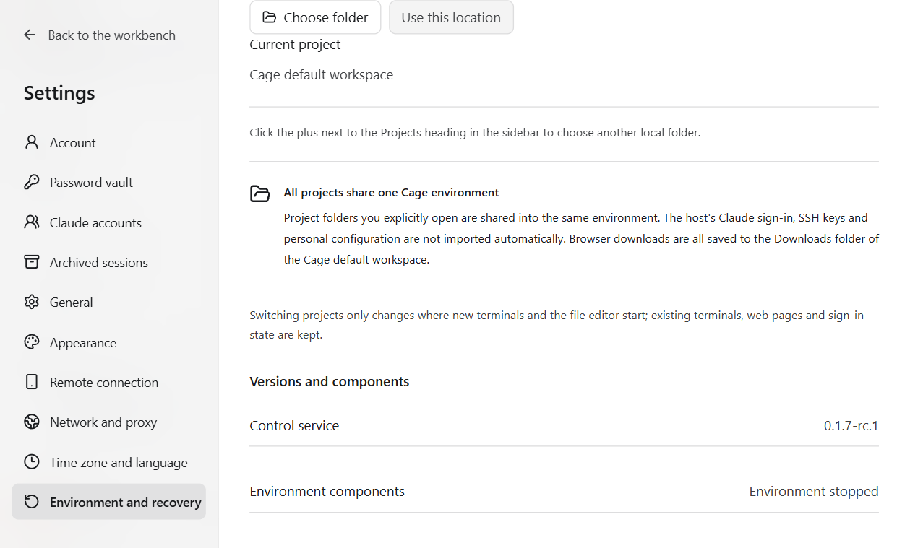

## Where data is stored

The default configuration root is `.claude-cage` under the current user's home directory. Accounts, settings, bookmarks and the password vault are configuration data. Browser history, website sign-ins, tools and files inside the environment also depend on the persistent virtual disk. Local shared projects stay in their original project directories. When `CLAUDE_CAGE_CONFIG` is set, later launches and maintenance should keep using the same absolute path.

Cloud data is on the server, including the configuration, projects and the persistent file system of the container engine. This computer keeps only the connection and the copies you explicitly download. Do not back up just one account file, or treat rebuilding the account as recovery.

<figure class="guide-shot">
  
  <figcaption>Environment storage location and version component entry. Screenshot version: 0.1.7-rc.1 (development build) · UI test stand on Windows 11 x64 · 2026-11-11. <a href="../../www/public/docs/screenshots/environment-maintenance.jpg" target="_blank" rel="noopener">View original (2560 × 1764) ↗</a></figcaption>
</figure>

## 环境清理

入口：“设置 → 环境与恢复 → 环境清理”。macOS、Windows 和 Linux 共用这一流程，操作只作用于当前选中的工作环境。需要先启动环境；Windows 新增的维护能力需要同步当前应用的环境组件。

1. 点击“只读盘点”。Cage 查看允许清单内缓存的大小、文件数量，以及账户、网站登录和会话存储等受保护位置是否存在。盘点不写入环境，也不读取凭据、Cookie 值或会话正文。文件存在状态不能判断是否已登录，以账户页和客户端实际显示为准。
2. 勾选可清理项，点击“清理所选缓存”，核对确认框中的项目与大小。预览有效期为 10 分钟，执行前会重新核对进程和文件状态；缓存变化后需重新盘点。
3. 查看结果。选定缓存移入环境内的私有恢复批次，原权限与内容保留。运行中的相关客户端、链接、挂载点、未知或不可访问目录均保留。不会强制关闭应用、终端或任务。
4. 需要撤销时，在同一面板找到“缓存恢复批次”，点击“恢复此批缓存”。原位置已有新文件或客户端正在运行时，该项保留恢复副本并说明原因，不覆盖新数据。

清理范围仅包含已知位置的 Claude Code `cache`、浏览器及 Claude Desktop 的 `Cache`、`Code Cache`、`GPUCache`。账户配置、登录凭据、钥匙串、Cookie、网站存储、会话、项目、技能、插件、浏览器历史与持久磁盘均不清理。没有发现某项缓存时不会创建它；相关应用仍在运行时，对应缓存会保留，关闭网页标签不一定结束浏览器进程。

恢复副本仍占用空间，不会自动删除，因此清理完成不代表已释放磁盘空间。缓存可由客户端重新生成，首次加载可能稍慢。中途失败或连接中断后，保留原文件与恢复记录，重新盘点查看已完成的批次；不要直接重放旧清单或删除恢复目录。

盘点、清理和恢复均由 Cage 内置程序执行，无需 Agent。打开设置、启动环境和后台运行都不会自动盘点或清理。该功能用于本地缓存维护，不改变账号状态或承诺解除平台限制。

盘点、保护资料与可恢复处理的流程借鉴了 [claude-post-ban-cleanup](https://github.com/l2461090/claude-post-ban-cleanup) 和 [Claude-Guardian](https://github.com/DUNHKpcc/Claude-Guardian)。感谢社区项目提供参考；Cage 根据自身多账户与三平台边界独立实现，未集成其账户重置、ID 轮换或整机环境修改脚本。

## Move the environment to another disk

Path: "Settings → Environment and recovery → Local environment storage". This feature applies to the local VM. Cloud containers are maintained according to the server deployment plan.

1. Save your work in the editor and terminal, then choose an empty dedicated directory on a local disk. Do not choose a disk root, a network drive, a program directory, a configuration directory or a project directory.
2. Confirm the migration. Cage stops the environment and terminals, copies and verifies the data, and switches the storage path after success.
3. Start the environment manually and check files, browser sign-ins and tools.
4. After confirming everything works, clean up the old backup shown by this migration in the panel. Old caches may be used by other Lima instances, so they stay in their original location.

The target disk needs enough space and must support permissions and sparse files. An external disk must be reconnected before every future launch. If the disk cannot be found, connect the original disk first, and do not create a new environment that would overwrite the state.

<figure class="guide-shot">
  
  <figcaption>Form for manually adjusting memory and CPU limits. Screenshot version: 0.1.7-rc.1 (development build) · UI test stand on Windows 11 x64 · 2026-11-11. <a href="../../www/public/docs/screenshots/resources-manual.jpg" target="_blank" rel="noopener">View original (2560 × 1764) ↗</a></figcaption>
</figure>

## Set CPU and memory

Path: "Settings → Environment and recovery → Compute resources". By default, resource limits are assigned automatically based on this computer's resources, and the actual range is decided by the host and platform. To control them manually, turn off "Assign resource limits automatically", then enter memory in GiB and the number of logical CPU cores within the range the page allows.

Click "Save resource settings" to take effect on the next launch. While running, you can click "Restart and apply the saved settings". Save your work first, because restarting ends commands in progress. Memory can grow and be reclaimed as needed within the limit. Setting a limit does not mean all memory is always fully in use.

Cloud resources are limited by the server deployment. The workbench shows verification information and cannot promise editing or live statistics the way a local VM can. When a task exits with code 137, combine the OOM count and diagnostics to judge, rather than concluding that memory is insufficient from the exit code alone.

## Three kinds of updates

| What is updated | Where to act | Effect |
| --- | --- | --- |
| Desktop Cage app | The app update entry, or download the full installer and replace it manually | Installing ends related environments and terminals; persistent data is kept. Cloud servers are maintained separately. |
| Environment components | Settings → Environment and recovery → Versions and components → Update environment components | May restart the browser and editor. On Linux, the workbench's standalone terminal is usually kept, while terminals inside the editor may end. On native macOS and Windows, end the workbench terminals and Claude Code turns in use first. |
| Environment tools | "Update environment tools" on the same page | Updates tools to the versions the current app specifies. Requires the environment to be ready. Update incompatible components first. |

操作前保存工作。替换 App 不代表持久环境中的所有组件已经更新，看到版本不匹配时按页面同步。环境组件与工具维护下载经过所选代理，手动暂停业务外网不会被维护操作解除。

桌面应用的更新检查和安装包下载优先使用主机网络，遵循系统代理及主机代理环境变量；主机连接失败或等待响应超时后再尝试 Cage 所选代理。主机已收到的版本不存在、访问拒绝或限流响应会直接显示，限流提示中的等待时间继续有效。下载开始后若传输中断，可在原入口重试。

On native macOS and Windows, "Update environment components" checks the actual files against the component list of the current app and can repair missing or damaged components. "Update environment tools" updates to the tool versions the current app specifies. Windows maintenance also requires checking the host authorization and guest administrator identity as prompted. After a failure, first check the cause and keep the original configuration, disk and recovery records, then retry the original operation. Do not recreate the environment. Full elevation on native Windows, guest service restart and upgrade with the final signed package still need separate verification.

macOS 自动安装要求相同发布者的 Developer ID 签名与 Apple 验证。Windows 安装包须具有可信 Authenticode 签名；发布者还须满足以下任一条件：与当前应用的发布者公钥相同，或证书主体的国家与组织均相同。证书续期更换密钥时也按这些条件校验。未签名 Windows 预览版与 Linux 使用完整安装包手动更新。自动更新下载失败可在原入口重试。

Windows 自动安装失败时，会先核对原程序是否完整；原程序完整时直接重新打开，已经替换且新版无法就绪时尝试恢复原程序。恢复会保留项目的最新内容、账户、配置、登录凭据和持久磁盘。若个人文件的迁移或恢复尚未完成，程序会保留备份与事务回执并停止自动启动；此时不要删除这些材料或重复覆盖安装。

Windows v0.1.7 升级到包含自动更新修复的后续版本时，需要手动安装一次完整安装包：先保存工作、停止环境并退出 Cage，再运行修正版安装器，沿用原安装目录和同一 Windows 用户。安装会保留账户、配置、登录凭据、项目和原有环境磁盘。重新打开后核对账户、项目与环境；此后的版本可继续通过应用内更新。若旧更新已留下待处理的恢复回执，先按下文的恢复说明处理。

<figure class="guide-shot">
  
  <figcaption>Version and environment maintenance in the Windows native app. Screenshot version: 0.1.7-rc.1 (development build) · UI test stand on Windows 11 x64 · 2026-11-11. <a href="../../www/public/docs/screenshots/windows-native-storage.png" target="_blank" rel="noopener">View original (1259 × 759) ↗</a></figcaption>
</figure>

## Restore configuration and export diagnostics

"Restore the previous configuration" stops the environment first, then restores the last saved configuration. It cannot restore commands that have already ended, nor revert project file changes. Read the prompts on the page and save your content before running it.

The log diagnostics on the same page can export a ZIP. If the app interface is unavailable, you can also export from the command line following [Troubleshooting](troubleshooting.md#export-diagnostics-and-feedback). Logs are kept for 14 days by default, with a total budget of 50 MiB. This does not replace your own data backups.

## Back up, reinstall and uninstall

Save your files first, then stop the environment and related background processes, and back up the complete configuration root, the chosen environment storage, shared projects and server engine data. A full backup needs to be consistent at a single point in time. Running processes and temporary terminal output cannot be recovered from a disk backup.

Installing, reinstalling, updating and uninstalling only manage app files, and personal data is kept. When you install again, use the original configuration and data paths. When you need to move to another machine, roll back or migrate manually, first confirm that accounts, bookmarks, the password vault and the persistent disk can be restored together.

The Windows installer keeps existing projects, files and links inside the program directory. Modified files with the same name as files in the new version, and old executable libraries in the program load directory whose ownership cannot be confirmed, are saved in the `Cage-preserved-files` subdirectory of the install directory. Extra changes made during installation may also be saved in the `late-` subdirectory of that directory. If personal files remain after uninstalling, the install directory is kept, and reinstalling can reuse this directory.

When Windows installation recovery is blocked by a file in use or a path conflict, a receipt with the same name, `.cage-installation.json`, is kept next to the install directory. It records the original installation, candidate and backup directories. Keep the receipt and the listed directories, locate your personal files based on the error, then recover. Automatic updates stop the app from starting while recovery is incomplete.

macOS automatic updates and development installs verify the integrity of the old app bundle, and keep the old bundle if verification fails. Cleanup of old copies also keeps app bundles whose integrity cannot be confirmed, to avoid removing personal files added inside the bundle.

Backups also need to cover the guest's full identity. For macOS, save the system disk, virtual hardware model, machine identifier and auxiliary storage together. For Windows, save the VM configuration, system disk and the associated virtual TPM state together. Changing the guest system requires a separate install that keeps the original environment. You cannot complete the conversion by rebuilding the account or initializing the original disk. See [Existing environments and changing the guest system](guest-systems.md#existing-environments-and-changing-the-system).

Do not initialize over user data, bulk-delete containers, or run `docker system prune` to fix update failures. Before recovery, keep the originals and backups, and if the original account disappears, check [Data directory](troubleshooting.md#original-account-and-data-seem-to-be-gone) first.
