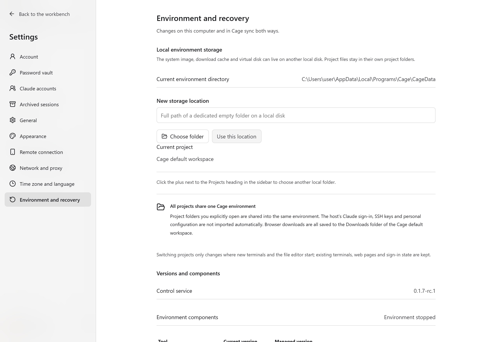
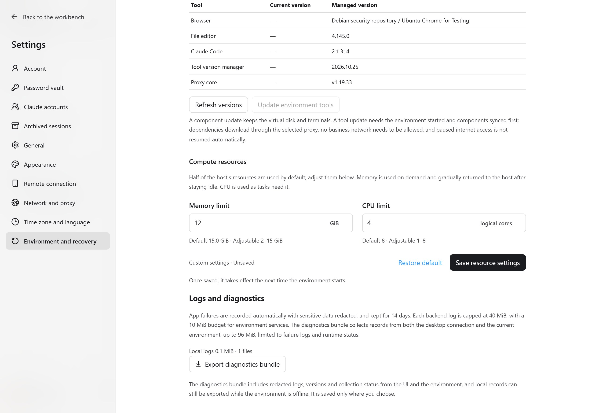
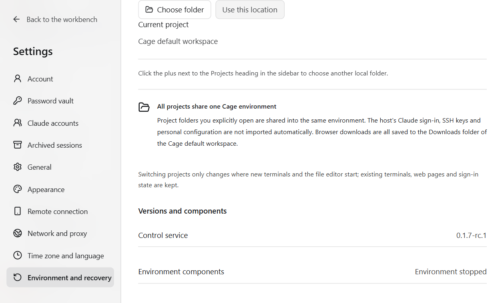

## Where data is stored

The default configuration root is `.claude-cage` under the current user's home directory. Accounts, settings, bookmarks and the password vault are configuration data. Browser history, website sign-ins, tools and files inside the environment also depend on the persistent virtual disk. Local shared projects stay in their original project directories. When `CLAUDE_CAGE_CONFIG` is set, later launches and maintenance should keep using the same absolute path.

Cloud data is on the server, including the configuration, projects and the persistent file system of the container engine. This computer keeps only the connection and the copies you explicitly download. Do not back up just one account file, or treat rebuilding the account as recovery.

<figure class="guide-shot">
  
  <figcaption>Environment storage location and version component entry. Screenshot version: 0.1.7-rc.1 (development build) · UI test stand on Windows 11 x64 · 2026-11-11. <a href="../../www/public/docs/screenshots/environment-maintenance.jpg" target="_blank" rel="noopener">View original (2560 × 1764) ↗</a></figcaption>
</figure>

## Move the environment to another disk

Path: "Settings → Environment and recovery → Local environment storage". This feature applies to the local VM. Cloud containers are maintained according to the server deployment plan.

1. Save your work in the editor and terminal, then choose an empty dedicated directory on a local disk. Do not choose a disk root, a network drive, a program directory, a configuration directory or a project directory.
2. Confirm the migration. Cage stops the environment and terminals, copies and verifies the data, and switches the storage path after success.
3. Start the environment manually and check files, browser sign-ins and tools.
4. After confirming everything works, clean up the old backup shown by this migration in the panel. Old caches may be used by other Lima instances, so they stay in their original location.

The target disk needs enough space and must support permissions and sparse files. An external disk must be reconnected before every future launch. If the disk cannot be found, connect the original disk first, and do not create a new environment that would overwrite the state.

<figure class="guide-shot">
  
  <figcaption>Form for manually adjusting memory and CPU limits. Screenshot version: 0.1.7-rc.1 (development build) · UI test stand on Windows 11 x64 · 2026-11-11. <a href="../../www/public/docs/screenshots/resources-manual.jpg" target="_blank" rel="noopener">View original (2560 × 1764) ↗</a></figcaption>
</figure>

## Set CPU and memory

Path: "Settings → Environment and recovery → Compute resources". By default, resource limits are assigned automatically based on this computer's resources, and the actual range is decided by the host and platform. To control them manually, turn off "Assign resource limits automatically", then enter memory in GiB and the number of logical CPU cores within the range the page allows.

Click "Save resource settings" to take effect on the next launch. While running, you can click "Restart and apply the saved settings". Save your work first, because restarting ends commands in progress. Memory can grow and be reclaimed as needed within the limit. Setting a limit does not mean all memory is always fully in use.

Cloud resources are limited by the server deployment. The workbench shows verification information and cannot promise editing or live statistics the way a local VM can. When a task exits with code 137, combine the OOM count and diagnostics to judge, rather than concluding that memory is insufficient from the exit code alone.

## Three kinds of updates

| What is updated | Where to act | Effect |
| --- | --- | --- |
| Desktop Cage app | The app update entry, or download the full installer and replace it manually | Installing ends related environments and terminals; persistent data is kept. Cloud servers are maintained separately. |
| Environment components | Settings → Environment and recovery → Versions and components → Update environment components | May restart the browser and editor. On Linux, the workbench's standalone terminal is usually kept, while terminals inside the editor may end. On native macOS and Windows, end the workbench terminals and Claude Code turns in use first. |
| Environment tools | "Update environment tools" on the same page | Updates tools to the versions the current app specifies. Requires the environment to be ready. Update incompatible components first. |

Save your work before you act. Replacing the app does not mean that every component in the persistent environment has been updated, so when you see a version mismatch, sync as the page directs. Maintenance downloads go through the selected proxy, and manually paused internet access is not lifted by maintenance operations.

On native macOS and Windows, "Update environment components" checks the actual files against the component list of the current app and can repair missing or damaged components. "Update environment tools" updates to the tool versions the current app specifies. Windows maintenance also requires checking the host authorization and guest administrator identity as prompted. After a failure, first check the cause and keep the original configuration, disk and recovery records, then retry the original operation. Do not recreate the environment. Full elevation on native Windows, guest service restart and upgrade with the final signed package still need separate verification.

Automatic installation on macOS requires a Developer ID signature from the same publisher and Apple verification. Windows needs a trusted Authenticode signature and the same publisher's public key. Unsigned Windows preview builds and Linux are updated manually with the full installer. If an automatic update download fails, retry from the same entry.

<figure class="guide-shot">
  
  <figcaption>Version and environment maintenance in the Windows native app. Screenshot version: 0.1.7-rc.1 (development build) · UI test stand on Windows 11 x64 · 2026-11-11. <a href="../../www/public/docs/screenshots/windows-native-storage.png" target="_blank" rel="noopener">View original (1259 × 759) ↗</a></figcaption>
</figure>

## Restore configuration and export diagnostics

"Restore the previous configuration" stops the environment first, then restores the last saved configuration. It cannot restore commands that have already ended, nor revert project file changes. Read the prompts on the page and save your content before running it.

The log diagnostics on the same page can export a ZIP. If the app interface is unavailable, you can also export from the command line following [Troubleshooting](troubleshooting.md#export-diagnostics-and-feedback). Logs are kept for 14 days by default, with a total budget of 50 MiB. This does not replace your own data backups.

## Back up, reinstall and uninstall

Save your files first, then stop the environment and related background processes, and back up the complete configuration root, the chosen environment storage, shared projects and server engine data. A full backup needs to be consistent at a single point in time. Running processes and temporary terminal output cannot be recovered from a disk backup.

Installing, reinstalling, updating and uninstalling only manage app files, and personal data is kept. When you install again, use the original configuration and data paths. When you need to move to another machine, roll back or migrate manually, first confirm that accounts, bookmarks, the password vault and the persistent disk can be restored together.

The Windows installer keeps existing projects, files and links inside the program directory. Modified files with the same name as files in the new version, and old executable libraries in the program load directory whose ownership cannot be confirmed, are saved in the `Cage-preserved-files` subdirectory of the install directory. Extra changes made during installation may also be saved in the `late-` subdirectory of that directory. If personal files remain after uninstalling, the install directory is kept, and reinstalling can reuse this directory.

When Windows installation recovery is blocked by a file in use or a path conflict, a receipt with the same name, `.cage-installation.json`, is kept next to the install directory. It records the original installation, candidate and backup directories. Keep the receipt and the listed directories, locate your personal files based on the error, then recover. Automatic updates stop the app from starting while recovery is incomplete.

macOS automatic updates and development installs verify the integrity of the old app bundle, and keep the old bundle if verification fails. Cleanup of old copies also keeps app bundles whose integrity cannot be confirmed, to avoid removing personal files added inside the bundle.

Backups also need to cover the guest's full identity. For macOS, save the system disk, virtual hardware model, machine identifier and auxiliary storage together. For Windows, save the VM configuration, system disk and the associated virtual TPM state together. Changing the guest system requires a separate install that keeps the original environment. You cannot complete the conversion by rebuilding the account or initializing the original disk. See [Existing environments and changing the guest system](guest-systems.md#existing-environments-and-changing-the-system).

Do not initialize over user data, bulk-delete containers, or run `docker system prune` to fix update failures. Before recovery, keep the originals and backups, and if the original account disappears, check [Data directory](troubleshooting.md#original-account-and-data-seem-to-be-gone) first.
