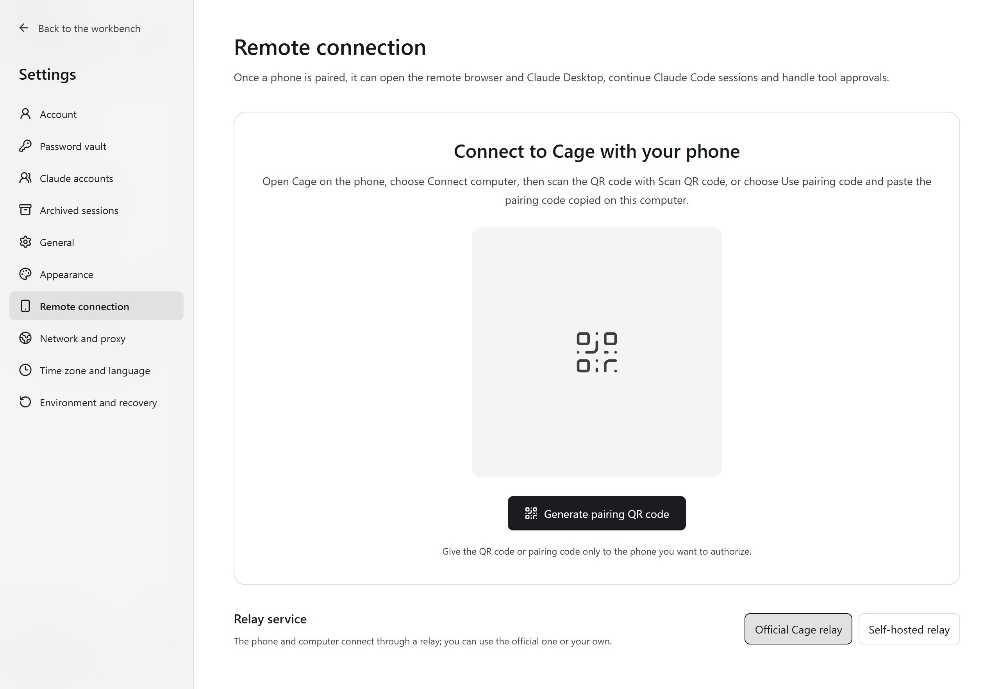

## Get the client and requirements

Install the Cage phone client on an Android or iPhone, then pair it with your computer. Android needs an arm64 device running Android 8.0 or later, with a current System WebView. iPhone needs iOS 17+ and a Secure Enclave. Your phone and computer should use matching versions.

Android users can choose Android in the [website download section](https://lee-xeo.github.io/Claude-Cage/#download), download the APK, and allow installs from that source when the system prompts. Later, install newer APKs with the same signature over the existing app, and the pairing records on the phone are kept.

iOS users build the app on their own Mac and sign it for their device. The steps are below.

The computer must run Cage, have the account unlocked, and have the environment ready. The phone handles the connection and display, while Claude Code, the network exit, time zone and language are managed by Cage on the paired computer. If the computer goes offline or the environment is stopped, the phone can no longer run tasks in that environment.

When the desktop app switches to a server over SSH, the phone interface still points to the original computer's local Cage. Switch back to the local workbench to manage phone pairing.

## Build locally for iOS

1. Install full Xcode and the iOS SDK on your Mac, and open Xcode once to finish installing its components. Prepare Node.js 24 and Go. The Go version follows `go.mod` in the repository.
2. Download the [Cage source code](https://github.com/Lee-xeo/Claude-Cage), and run the following commands in the repository root to generate the phone interface, the native connection library and the iOS app.

   ```sh
   npm ci --prefix ui
   bash mobile/build.sh ios
   open mobile/ios/CageMobile.xcodeproj
   ```

3. In Xcode, select the `CageMobile` scheme, choose your own development team under Signing & Capabilities, connect your iPhone and select it, then click Run. Follow the device prompts to trust the development signature and enable developer mode.

The build output is in `mobile/.build/ios/`, and device certificates and signing are managed by your own Apple developer account. After installing, pair your computer as described below. To export a development IPA for installing on your own device, see the [mobile build guide](https://github.com/Lee-xeo/Claude-Cage/blob/main/mobile/README.md#build-for-ios-locally).

<figure class="guide-shot">
  <a href="../../www/public/docs/screenshots/mobile-pairing.jpg" target="_blank" rel="noopener" aria-label="View original: phone pairing entry and relay choice on the computer"></a>
  <figcaption>Phone connection entry and relay choice on the computer. Screenshot version: 0.1.7-rc.1 (development build) · UI test stand on Windows 11 x64 · 2026-11-11. <a href="../../www/public/docs/screenshots/mobile-pairing.jpg" target="_blank" rel="noopener">View original (2560 × 1764) ↗</a></figcaption>
</figure>

## Scan a QR code or use a pairing code

1. On the computer, go to "Settings → Remote connection → Phone connection" and click "Generate pairing QR code". The QR code is valid for about two minutes. Refresh it after it expires.
2. On the phone's home page, tap "Connect computer → Scan QR code", allow camera access, and scan the complete QR code.
3. If the camera is inconvenient, click "Copy pairing code" on the computer, then select the pairing code entry on the phone and paste this one-time code.
4. After a successful connection, the left sidebar opens. Tap a tool to use it in the main area, and tap the Cage logo in the upper-left corner to reopen the sidebar. Next time, reconnect a paired device from "Connect computer".

After connecting, the computer's pairing card shows the phone model and platform. Removing a pairing also shows the model, so you can confirm which device you are acting on. If it shows "Model not available yet", update Cage on your phone and reconnect. Existing pairings are kept, so you do not need to scan again.

A pairing code grants device access, so give it only to the phone you want to authorize. Locking the computer, refreshing it or a timeout makes unused codes invalid. After the computer restarts, start Cage first, then reconnect.

When a phone is paired and the Cage host is providing remote service in the background, the host is asked to stay awake. The screen can still turn off as usual, and the host stays on standby when the phone is temporarily disconnected or the host is reconnecting to the relay. Closing the window or choosing "Keep running and quit" still keeps the remote service and the keep-awake request active. Removing the pairing or ending the host background service releases the request, and the original system sleep settings apply again. "Settings → Remote connection" shows whether the keep-awake request was granted. If the system does not allow it, the specific reason is shown.

This feature prevents automatic system sleep. Closing the lid, manual forced sleep, shutdown and system power protection are still limited by the operating system and hardware. For long unattended remote use, keep the computer plugged in, so the system does not cancel the keep-awake request in battery mode.

## Create sessions and handle tool approvals

In the "Claude Code" section of the left sidebar, tap a project name, expand it, then tap a session to enter the conversation. The phone automatically connects to existing sessions or restores history, so you do not need to tap a resume button or go back to the computer to confirm the Cage channel. While the connection is being prepared, you can type a message first, and the send button becomes available once the connection is ready. You can also create a new session next to the target project. On the phone, you can view replies, execution progress and saved history, and you can stop the current turn while it runs. If there are no projects, first add a directory explicitly in the computer's workbench.

Titles, lists, quotes, code and tables in a session are formatted as Markdown. Wide tables and long code lines can be scrolled sideways. Tap "Tool calls" to see the name and status of each call, plus any short description recorded with it. Background task notifications show a summary directly. Expand them to see the task ID and output path.

When a reply references media files in the current project with Markdown links, image syntax or inline code, tap "View image" or "Load video" to preview them in the conversation. Files are transferred from the computer to the phone over the paired connection, with a 48 MiB limit per file. PNG, JPEG, GIF and WebP are supported, along with MP4, M4V, MOV and WebM videos that the phone can decode. Public links open in the Cage remote browser on the computer. Project file preview and tool call history require both the phone and the computer to use versions that support this feature.

When a tool needs to run, the phone shows the tool name and parameters, and you choose "Allow once" or "Deny". Check the command, file path and scope of operation in the parameters first. If the same approval has already been handled on the other end, the latest status is read again.

Swipe a session row from right to left, and the pin, rename and archive icons appear on the right, in the same row as the session. You can also expand it with the more-actions button. The left arrow key expands it, and the right arrow key or Escape collapses it. Name, pin and archive status sync between the computer and the phone. Archiving closes the associated terminals and keeps the history.

Under "Settings → Archived sessions", you can search sessions, filter by project, and restore them to the project list with "Unarchive". The trash button permanently deletes a session. It asks for confirmation again and removes the corresponding original Claude Code conversation and sub-agent records. Deletion cannot be undone. When the host environment is offline, you can view and unarchive sessions, but permanent deletion requires starting the host environment.

You can select sessions for batch actions on both the computer and the phone. "Select all" above the list selects the current filtered results. The checkbox in front of a project name selects the sessions currently shown under that project. You can also select items one by one, then click "Unarchive selected" or "Delete selected". Changing the search or filter clears the selection. Batch deletion requires confirmation. If some actions fail, successful items are removed from the archived list and failed items stay selected, so you can view the reasons and retry. For sessions whose deletion did not finish, you can only retry the deletion. They cannot be unarchived.

The computer and the phone read the same session directory. A session created on the phone can also be opened directly on the computer, and both ends share the history, messages and approvals. After a background restart, history sessions remain in the list, and tapping a session on either end lets you resume it. When you switch sessions on the phone, each keeps its own draft, and leaving the page does not close the task on the host. Existing history is checked against the original account and project before resuming. If the original configuration cannot be verified, the history is kept and the specific problem is reported.

When the connection is briefly interrupted, the phone automatically retries five times, with gradually longer intervals. During recovery, the current progress is shown, and the chat history and drafts are kept. If the send result is unclear, the app first checks whether the message was delivered. If a retry is needed, it reuses the original message to avoid running it twice. Once the host confirms receipt, "Message delivered" is shown right away, and the reply syncs afterwards. If the connection is still not restored after five attempts, the message explains whether the problem is between the phone and the computer, or between the computer and the runtime environment. Tap "Connect again" to continue recovery. You do not need to copy the original message manually.

Existing Claude Code history in authorized projects also appears in the list. Opening one automatically resumes an idle session. Tasks waiting for approval ask the phone for approval again. Tasks that are running keep running and connect automatically when they finish. Shared sessions reuse the current process directly. When the account has expired, the host is offline, or organization policy blocks the connection, the page shows the actual error. Resuming checks the account and service address, and refuses to continue if the identity has changed. Configurations whose identity cannot be verified only support the first turn. You can start a new session as prompted.

<figure class="guide-shot guide-shot-phone">
  <a href="../../www/public/docs/screenshots/mobile-ios-preview.jpg" target="_blank" rel="noopener" aria-label="View original: session interface preview in the native phone client"></a>
  <figcaption>Session interface preview in the native phone client. Screenshot version: Cage iOS 0.1 (build 1, development build) · iPhone 17 Pro simulator · iOS 26.5 · 2026-11-07 · Interface preview with a sample conversation, not connected to a host. <a href="../../www/public/docs/screenshots/mobile-ios-preview.jpg" target="_blank" rel="noopener">View original (456 × 972) ↗</a></figcaption>
</figure>

## Open the remote browser on your phone

1. Start the environment on the computer and pass the network check.
2. Connect using the QR code or pairing code generated on the computer. An already paired phone can reconnect directly.
3. Tap "Browser" in the phone's left sidebar to open the "New tab address" set in the computer's Cage browser settings. Once the computer saves a new address, it takes effect the next time you open the browser from the phone. The "Claude.ai" entry always goes directly to Claude.ai.
4. Tap the web input box, then use "Enter text" to bring up the phone keyboard. Tap the checkmark to insert, and tap "Send Enter" when you need to submit.

Tap "Bookmarks" at the bottom of the phone browser to browse bookmarks by the folders on the computer, open URLs, or save the current page to a chosen folder. Both ends share the bookmarks of the paired host. When the other end makes changes, reopen Bookmarks or tap refresh on the phone to see them.

Web pages run in the Cage browser on the computer, and each paired phone uses its own browsing data, so you need to sign in once in this window. A normal close keeps the sign-in data for that pairing. Removing the pairing or locking Cage ends access.

The phone browser shows one web page at a time and supports HTTP/HTTPS over public IPv4. For web popup sign-ins, attachment upload and download, or sound playback, go back to the computer workbench.

## Use Claude Desktop from your phone

Install and sign in to Claude Desktop inside the Cage environment on the computer. Connect to the computer with a paired phone, then tap "Claude Desktop" in the phone's left sidebar to pick up the same window on the computer. Both ends share the account, app data, page and input focus, and your actions on the phone are shown on the computer in sync. If the app is not running, the host starts it.

The newer phone client automatically reads the screen pixel density, so the remote picture matches the current display resolution. The shared window is re-laid out to the phone's width, and the computer shows that layout in sync. To see details, tap "Zoom to read" and drag to view parts of the screen. When you leave the Desktop page on the phone, the computer's size is restored, and the app and tasks on the computer keep running. When you need to sign in again or use the local file picker, do it on the computer.

The phone Desktop on Windows guests is connected to the shared window, focus and size protocol. Older guest components prompt for an update, and after the screen locks you need to unlock the bound account on the computer. It has passed the production interface and isolated graphics protocol checks. The full flow for the official Windows Claude window, real mouse and screen lock, and a physical phone WebView still needs verification. The usable scope depends on the computer build, guest components and platform verification.

## Network drops, switching devices and revoking

After a brief network drop, stay on the current session. When the network comes back, the latest progress is read and the computer's identity is checked again. Input drafts are kept. If the connection drops while sending or approving, check the host record first to avoid repeating the action. A task the host has already accepted keeps running.

Tap the Cage logo to open the sidebar, tap "Exit" at the bottom to return to the home page, then choose another computer from the connected devices under "Connect computer". Long-press a device and confirm "Cancel connection" to close that device's connection. The pairing record is kept. Choose "Forget host" on the phone to clear the locally saved connection. To revoke the authorization on the computer, you also need to remove the matching pairing under "Settings → Remote connection" on the computer.

## Use a self-hosted relay

On the computer, choose a self-hosted relay under "Settings → Remote connection" and save its HTTPS address, then enter the same address in the phone's settings. Enter the management token only on the computer, if one is required. After saving, generate a new pairing code. Existing pairings are not moved automatically to another relay. To migrate, revoke and pair again.

The relay only forwards connections and does not run your projects. It can see connection addresses, times and traffic volume. The computer and phone verify identity and encrypt communication inside the forwarding channel. A self-hosted relay requires a deployment program that matches the phone protocol. For deployment materials and the command-line connection helper, see the [relay guide](https://github.com/Lee-xeo/Claude-Cage/blob/main/deploy/relay/README.md).
