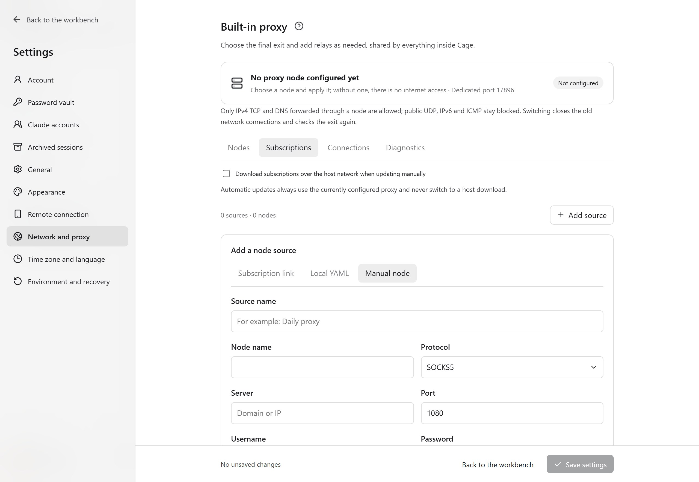
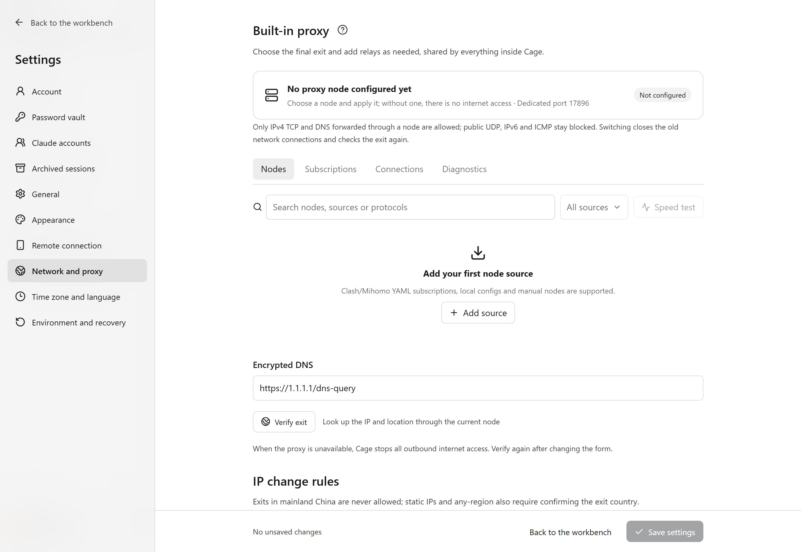
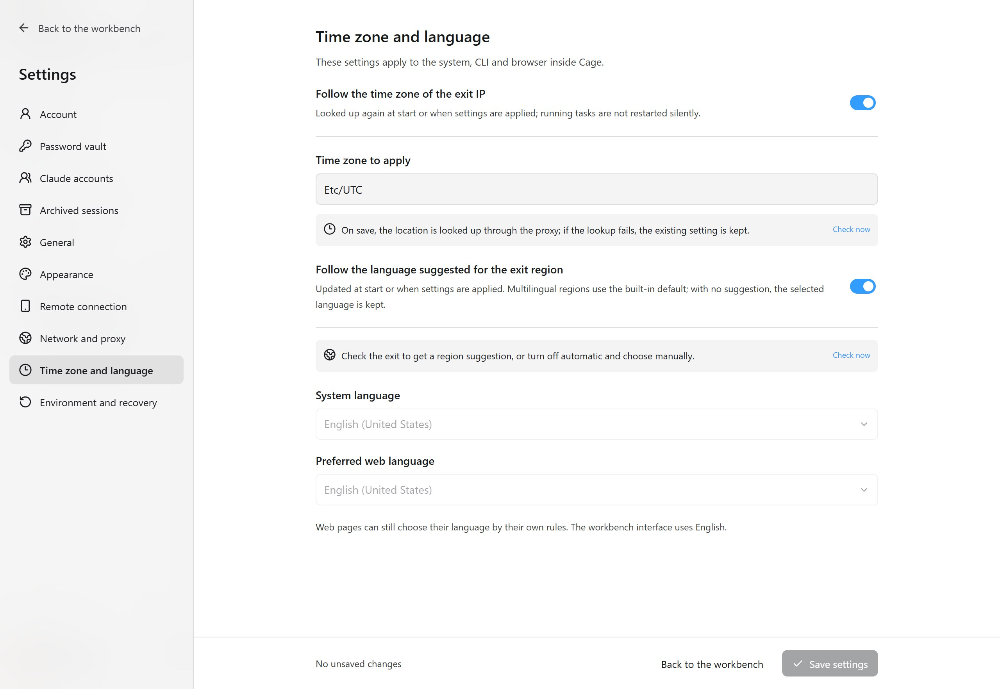

<figure class="guide-shot">
  
  <figcaption>Adding a subscription link and the first-time host download option. Screenshot version: 0.1.7-rc.1 (development build) · UI test stand on Windows 11 x64 · 2026-11-11. <a href="../../www/public/docs/screenshots/proxy-subscription.jpg" target="_blank" rel="noopener">View original (2560 × 1764) ↗</a></figcaption>
</figure>

## Import your own proxy

Open it from "Set up network and proxy" on the home page, or go to "Settings → Network and proxy". Click "Add source" and choose an import method:

| Source | How to fill it in |
| --- | --- |
| Subscription link | Enter a name and an HTTPS node subscription URL. If there are no usable nodes the first time, you can explicitly tick "Download this subscription over the host network". |
| Local YAML | Drag in or click to select an exported YAML, YML or JSON file (up to 8 MiB each), or paste Clash/Mihomo YAML content directly. After it is read, you can edit it. Click "Import and verify" to finish the import. |
| Manual node | Enter the HTTP or SOCKS5 server, port and matching authentication fields. |

Click "Import and verify", then go to "Nodes", choose the final exit, and click "Apply proxy". "Save settings" is for other settings and cannot replace applying the proxy. Selections that have not been applied are only drafts.

A subscription must contain `proxies` or `payload` nodes. Base64 lists, single-node share links, and configurations that only reference remote providers are not supported yet. Import only adopts supported nodes and proxy chains, and does not adopt the host system proxy, TUN, listening ports or direct rules from the subscription.

Ordinary node parameters are kept and passed to the Mihomo core bundled with Cage for validation. For example, a VLESS node copied from FlClash can keep `xudp: true` without changing it to another field by hand. The core may ignore unknown fields. After configuration validation passes, you still need to apply the node and check the actual exit. The guest's public UDP blocking rule is not affected by these protocol options.

VMess, VLESS and Trojan WebSocket nodes can import the legacy fields `ws-path` and `ws-headers`. The node must explicitly set `network: ws`. Cage converts the path and headers to `ws-opts.path` and `ws-opts.headers`, and saved legacy nodes are converted when the proxy is applied. The new and legacy fields may coexist, but the paths must match, and headers are merged by name, ignoring letter case in names. If the values of the same header conflict, the field is written twice, or a legacy field is used for another transport, the source shows the specific reason, and you need to edit that node and import it again.

Hysteria2 nodes can use `mport` to specify a port-hopping range and `pinSHA256` to specify a certificate fingerprint. On import, these are converted to fields the core supports, and the features are kept. If a node uses an unsupported protocol, references a local file or network interface, has duplicate management fields, has conflicting alias parameters, or a proxy chain is unavailable, the node is skipped, and the source shows the number imported, the number skipped and the reasons. Click "See reasons" to expand the specific nodes. Proxy chains that depend on failed nodes are also skipped. If all nodes are skipped, the import fails. When an update affects the current exit or a relay node, the original configuration is kept, so apply another node first and then update. The remaining nodes must also pass the core configuration validation as a whole. If validation fails, the original configuration stays unchanged, and you can export a diagnostics bundle from "Logs and diagnostics" in settings to see the validation record.

The same subscription URL may return different formats depending on the client identity it requests. Cage downloads with a Clash client identity, so YAML from the provider can be imported. If the provider returns a Base64 or share-link list, you still need to get a Clash/Mihomo YAML from the provider.

<figure class="guide-shot">
  
  <figcaption>Entering an HTTP / SOCKS5 node manually. Screenshot version: 0.1.7-rc.1 (development build) · UI test stand on Windows 11 x64 · 2026-11-11. <a href="../../www/public/docs/screenshots/proxy-manual.jpg" target="_blank" rel="noopener">View original (2560 × 1764) ↗</a></figcaption>
</figure>

## Reach a residential exit through a relay

If a residential node cannot connect directly, switch to "Chained proxy" on the "Nodes" page. Choose the relays in connection order, set the residential node as the "Final exit", and click "Add relay" when you need multiple relays. Nodes can come from different sources.

Check the preview before applying, for example: `Cage → Relay node → Residential proxy → Target website`. The target website sees the final exit. Subscription updates do not overwrite saved combinations. If a node in use is removed, the original configuration is kept and an error is shown, and you need to choose again.

<figure class="guide-shot">
  
  <figcaption>Network and proxy page and exit change rules. Screenshot version: 0.1.7-rc.1 (development build) · UI test stand on Windows 11 x64 · 2026-11-11. <a href="../../www/public/docs/screenshots/network-settings.jpg" target="_blank" rel="noopener">View original (2560 × 1764) ↗</a></figcaption>
</figure>

## Why the node is applied but still offline

Proxy core readiness and the working environment being allowed to connect to the internet are two separate steps. After the environment starts, internet access for the business stays off while the critical checks run: exit, DNS, system and browser configuration, shared directories, host management interfaces and network blocking. For Linux guests, the DNS item also requires the resolver to point only to an address inside the environment, and direct UDP/53, TCP/53 and DoT/853 connections to public DNS must not bypass the gateway. The host management interface item also probes link-local metadata addresses and the configured user proxy port. The IPv6 item requires the guest to have zero global IPv6 addresses, and checks routing or reject records. If a probe result is missing, the state shows unknown. If any critical item fails or evidence is missing, internet access stays off.

Exit detection reads the public IPv4 address through the selected proxy, using `https://ipv4.icanhazip.com/` first and the backup service `https://api.ipify.org/` next. Dual-stack nodes use their IPv4 exit to complete the check. The host, guest terminal and browser use the same detection method. If the startup check cannot get a valid address, internet access for the business stays off. You can retry later or check the node.

Click the network status at the bottom to see the failed items, fix them, then check again. When the core is running but the environment has not started, it shows "Waiting to start environment". "Connected" is shown only when the critical checks pass and the network access authorization is valid.

"Exit sampling is incomplete" lists the paths that did not get a result, namely the host, the virtual machine terminal or the browser, along with reasons such as a timeout, the HTTP status returned by the detection channel, or a missing address. A passing terminal proxy check only proves that this terminal sample succeeded. The host and browser must each still get results. The dynamic IP rule decides which exit addresses are acceptable. When sampling fails, you still need to detect again.

If the browser's exit sampling gets no response or returns HTTP 503, Cage waits one second and retries once. Internet access stays off during the retry. If it keeps failing, the last detection result is kept. If the browser configuration does not match, or the response lacks an exit address, first fix the corresponding failed item. When the environment is ready but only the network check failed, the page shows "Environment started, but the network check did not pass", and you can recheck the network directly.

While offline, you can still use terminals, shared files and local services inside the environment. In the browser address bar, `localhost` refers to the current Cage guest. Start development servers in the Cage terminal.

<figure class="guide-shot">
  
  <figcaption>Time zone and language settings that follow the exit IP. Screenshot version: 0.1.7-rc.1 (development build) · UI test stand on Windows 11 x64 · 2026-11-11. <a href="../../www/public/docs/screenshots/region-settings.jpg" target="_blank" rel="noopener">View original (2560 × 1764) ↗</a></figcaption>
</figure>

## Download network for system images

System images, the image version catalog, and the macOS app and development toolkit prepared on the host use the host network, separate from the proxy nodes of the Cage guest. Software such as Clash can take over these downloads with only "System proxy" turned on, without TUN. Download connections are not bound to a physical network interface, and they do not change the nodes or rules of the proxy software. If the host proxy rules set a download site to direct, Cage follows that rule. When no proxy is configured on the host, direct connections are used.

- macOS: reads the system HTTP, HTTPS and SOCKS proxies and PAC. Each request and redirect is resolved by its target address.
- Windows: reads the current user's system proxy. PAC and auto-detection are resolved by target address through WinHTTP.
- Linux: supports proxy environment variables, the GNOME manual desktop proxy and host TUN. In this build, if GNOME automatic PAC is encountered, it stops and asks you to switch to TUN or proxy environment variables. For other desktop environments, set proxy environment variables or turn on TUN.

When started from a terminal, the `HTTP_PROXY` and `HTTPS_PROXY` for the target protocol take precedence over system settings, `ALL_PROXY` acts as the default proxy, and the matching `NO_PROXY` exceptions apply. These host settings are not passed into the guest. If the proxy cannot connect or the configured PAC fails to resolve, the download stops and does not switch to a direct connection because of the failure. After you fix the host proxy, continue the installation from the initialization screen, and existing downloads try to resume.

System images and development tools prefer official sources. If the Debian image download fails, Cage tries a mirror in mainland China of the same fixed version. Debian package sources and Linux tools try backup mirrors when official sources are unavailable. Each download path keeps its original digest, package signature or app signature checks, and custom Debian package sources are kept as they are.

Guest processes and development tools downloaded inside the guest still go through Cage's own proxy. A successful system image download does not mean that the guest network check has passed. Entering the workbench still requires the guest's network and isolation checks to complete.

## Time zone, language and exit rules

Under "Settings → Time zone and language", choose to follow the exit or set it manually. Automatic mode looks up the exit location through the proxy and does not use the host location instead. If location lookup fails, you can retry or switch nodes. When you set the time zone and language manually, you still need to confirm the exit country or region.

The "IP change rules" on the network page support a static IP, and a dynamic IP within the same city, the same country or region, or any region. City mode also checks the country and state or province. The saved exit baseline changes only after an explicit edit. Rechecking does not automatically accept a new address.

Exits in mainland China are not allowed. When the detected address matches the built-in mainland China network list, or the location result is mainland China, internet access for the business stays off. Neither a static IP nor "any region" can be exempted. If the exit country or region cannot be confirmed, it also stays off, while offline terminals and files remain usable. Location and the network list may have errors. Sampling runs periodically in the background, and it cannot guarantee that every connection of a third-party proxy uses the same exit.

Saving settings that affect the system environment may require a restart, so save your files first. A running task is not silently restarted just because the backend detects a location change.

## Pause, resume and network switching

Click the status at the bottom to pause internet access manually. Pausing cuts existing external connections and keeps local tasks and file operations. Closing and reopening Cage, or refreshing a subscription, does not lift a manual pause.

The backend periodically checks the exit and environment configuration. When both exit detection services time out, Cage keeps retrying before the current network permission expires, without extending it. If it is still unconfirmed when it expires, internet access is turned off and a full recheck is attempted. If the exit or environment configuration is found to break the rules, it pauses immediately. After the host switches networks, Cage tries to restore the connection and run a full recheck. A state that was paused manually still needs to be resumed manually. If the control service loses contact, existing network authorization expires and internet access is turned off. A fixed exit also depends on the proxy service itself, since periodic sampling cannot prove that every connection uses the same IP.

The first automatic full recheck is attempted 15 seconds later. After a failure, it waits 30, 60, 120 and 240 seconds in turn, and then 300 seconds each time. The actual start time also depends on environment readiness, the current operation and memory pressure. The network state shows the remaining wait time or the reason for waiting. A recheck must obtain all critical evidence, and automatic recovery does not change the saved exit rules.

## DNS and diagnostics

Business DNS is forwarded through the selected proxy. The startup resolution of node domains belongs to communication preparation and is separate from the guest's business DNS setting. Cage does not change the host's system proxy or TUN, nor does it change the nodes of other proxy software on this computer.

On the proxy page, "Diagnostics" can check the core status, restart the Cage core, or choose an independent listening port. If a port is in use, select an unused port, then restart the environment as prompted. For specific symptoms, see [Troubleshooting](troubleshooting.md#node-applied-but-no-internet-access).

## Use SSH over the Tailscale private network

Open "Tailscale" below "Browser" in the sidebar. After authorizing in the Cage browser, you can make SSH work in both directions over the private network between this computer and the Cage environment. For connection steps, public keys and local SSH service requirements, see [Tailscale and private-network SSH](tailscale.md).

Private-network access is enabled by you and is limited by device and SSH authorization. Outer traffic still goes through Cage's controlled exit, and pausing internet access or a proxy interruption affects the connection. This entry is handled separately from the host and LAN direct connections that are blocked by default, and it does not open public listening on the host or subnet routing.
