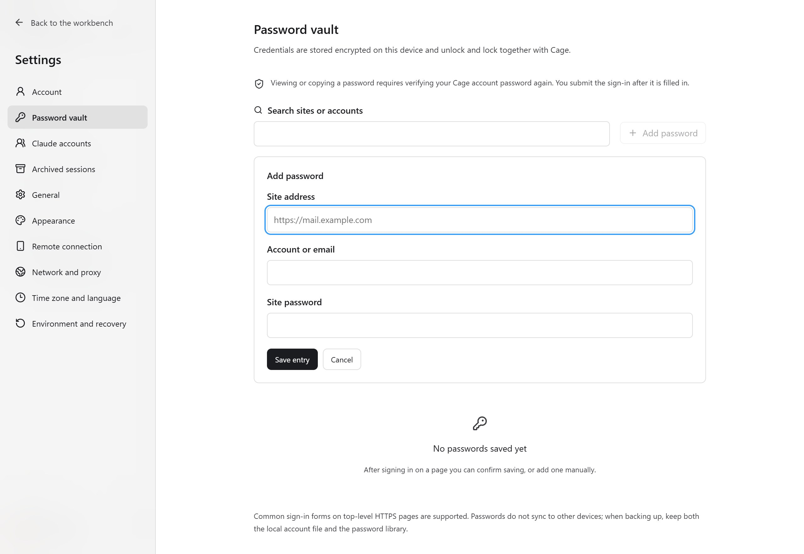
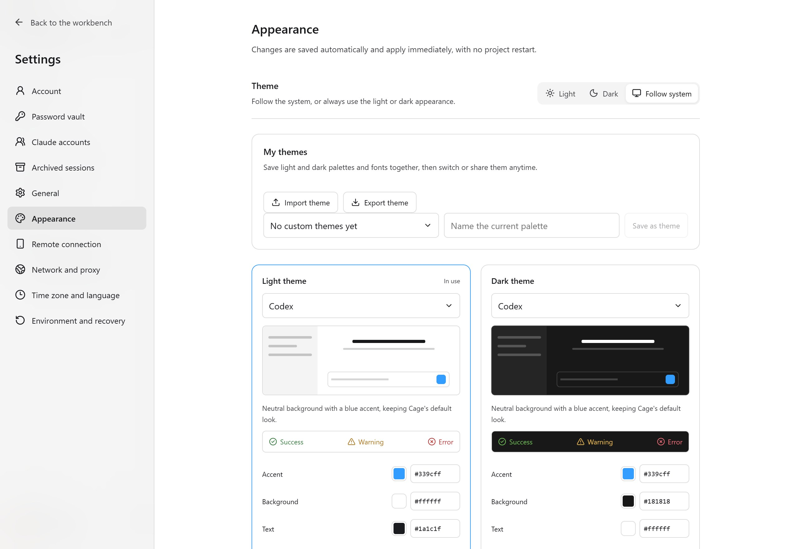

## Open settings and save

Click "Settings" in the avatar menu in the lower-left corner. Network and system configuration changes are applied with "Save settings" on the page. When a restart is needed, you are reminded to save your files first, because restarting ends terminal commands. Proxy nodes are applied separately with "Apply proxy".

Appearance changes take effect immediately and are saved automatically. If saving fails, click "Retry save". Keyboard and layout preferences on a remote client are saved on the current computer and do not change the server's runtime environment.

## Settings menu overview

| Entry | What you can set | When it takes effect |
| --- | --- | --- |
| Account | Avatar, username, password, remember sign-in and Touch ID where supported | Saved on the account page; verification is still needed after locking |
| Password vault | Website accounts, password records and save prompts | Takes effect after a record is changed; viewing or copying requires verification |
| 通用 | 时间显示格式、键盘习惯、Claude 终端启动命令、浏览器默认网站、流畅画质、项目文件缓存 | 时间格式保存后生效；其他项依说明生效 |
| Appearance | Light and dark theme, colors, font, font size, terminal and interaction preferences | Previewed immediately and saved automatically |
| Remote connection | Phone pairing for this computer, remote browser authorization, official or self-hosted relay | Takes effect after saving; relay migration requires pairing again |
| Network and proxy | Sources, nodes, proxy chains, DNS, exit rules and core diagnostics | Apply proxy or save; some changes need a restart |
| Time zone and language | Automatically follow the exit, or set the system and browser language manually | Apply, then restart as prompted |
| 环境与恢复 | 存储、资源、组件工具版本、只读盘点、缓存清理与恢复、配置恢复、诊断 | 具体影响见[维护说明](maintenance.md) |
| 关于 | 软件版本、构建提交、手动检测源码与发行版更新 | 点击“检测更新”后显示结果，包含预发行版 |

Claude Code 的多账号登录、备注、额度查询和调度在侧栏“Claude 账号管理”中操作，详见[多账号与额度](accounts.md)。分配选项影响新建 Claude 终端。

<figure class="guide-shot">
  
  <figcaption>Account profile, password and sign-in unlock settings. Screenshot version: 0.1.7-rc.1 (development build) · UI test stand on Windows 11 x64 · 2026-11-11. <a href="../../www/public/docs/screenshots/account-settings.jpg" target="_blank" rel="noopener">View original (2560 × 1764) ↗</a></figcaption>
</figure>

## 关于与手动检测更新

打开“设置 → 关于”查看当前软件版本与构建提交。点击“检测更新”后，页面分别显示主分支的最新提交与最新公开发行版；发行版检查包含预发行版，并提供发行说明和下载入口。检查优先使用主机网络，遵循系统代理及主机代理环境变量；主机连接失败或等待响应超时后，再尝试已应用且正在运行的 Cage 所选代理。Cage 环境停止时也能通过主机网络检查。两条路线均失败时，恢复网络后可重新检测。

源码检查会区分已同步、有新提交、当前构建领先和分叉。构建未记录提交时，页面会说明无法核对；包含未提交修改的构建会额外提示。源码有新提交时，可能还没有对应的新版安装包。手动检查只读取更新信息；需要安装时前往发布页选择对应平台的安装包。

连接远程主机时，“关于”显示本机软件信息。环境组件和工具版本仍在“环境与恢复”中查看。

## Account and sign-in

Cage 账户用于解锁当前环境。在云端工作台修改的是服务器账户。macOS 支持的记住登录和 Touch ID 与系统钥匙串绑定；迁移配置目录后可能需要用原密码重新授权。

### 保存恢复密钥

注册密码账户后会显示恢复密钥。请复制到密码管理器或下载密钥文件，确认保存完整后再继续。持有密钥的人可以重置密码并访问账户资料，请妥善保管。

已有账户在“设置 → 账户 → 恢复密钥”中输入账户密码，点击“生成恢复密钥”补设。完整密钥只在生成后显示，不写入浏览器存储或诊断日志。丢失密钥但仍知道密码时，可在同一位置重新生成；旧密钥随即失效。普通修改密码不会更换恢复密钥。

### 忘记密码

1. 在登录页点击“忘记密码？”，填写已保存的恢复密钥和新密码。
2. 重置成功后保存新生成的恢复密钥；旧密码和旧恢复密钥失效。
3. 返回登录页，用新密码进入。Cage 的“记住我”和快捷解锁授权已关闭，需要时重新开启。

恢复会保留账户、收藏、项目、历史、密码保险箱、持久磁盘及原有 Claude 登录状态。macOS 共用密码会在登录并启动环境后继续同步；已有改密尚未完成时，会先确认上次更新，再同步新密码。恢复密钥不包含个人数据，不能代替配置目录与持久磁盘的备份。

此功能不依赖在线找回服务。若此前未设置恢复密钥，且密码和所有快捷解锁方式均不可用，当前无法恢复加密资料。请保留原目录和完整备份，不要删除账户文件或重建环境。

"Lock Cage" keeps background tasks running, while "Sign out" stops the environment. The account password is not the password that encrypts the project disk. Do not recreate the account to deal with updates or directory problems.

<figure class="guide-shot">
  
  <figcaption>Form for manually adding a website password. Screenshot version: 0.1.7-rc.1 (development build) · UI test stand on Windows 11 x64 · 2026-11-11. <a href="../../www/public/docs/screenshots/password-add.jpg" target="_blank" rel="noopener">View original (2560 × 1764) ↗</a></figcaption>
</figure>

## Password vault

After a website sign-in succeeds, choose to save or update. You can also add, search, edit and delete entries manually in the vault, and restore the save prompt for a website. After filling in, you submit the web form yourself. Viewing and copying passwords requires entering your Cage password again.

It currently supports common sign-in forms on top-level HTTPS pages. Embedded frames, CAPTCHAs, passkeys and the like are not handled automatically. Incognito pages do not show save prompts. If an older environment reports that it is unavailable, update the environment components first.

Password records are saved in the current host's Cage configuration and do not sync automatically across devices. The vault for a cloud instance is on the server. When backing up, keep the account file and the password vault together. When Cage is locked, the vault is locked too, and it can also be unlocked along with the sign-in when remember-sign-in unlock is used.

<figure class="guide-shot">
  
  <figcaption>Terminal startup command, image quality and shortcut settings. Screenshot version: 0.1.7-rc.1 (development build) · UI test stand on Windows 11 x64 · 2026-11-11. <a href="../../www/public/docs/screenshots/general-settings.jpg" target="_blank" rel="noopener">View original (2560 × 1764) ↗</a></figcaption>
</figure>

## General and keyboard

“时间显示格式”控制工作台底部时钟，默认使用 24 小时制；选择 12 小时制后以 AM/PM 区分上午和下午。点击“保存设置”后生效并保留选择，无需重启环境。

"Claude terminal startup command" applies to newly created Claude terminals, for example `claude --continue`. Saving does not change existing terminals. A custom command must be compatible with the CLI you installed.

"Keyboard habits" decide how the workbench and guest input are mapped. With a Debian guest, Mac mode maps common Command combinations in web pages and the editor to Linux controls. macOS and Windows guests use the keyboard behavior of their own systems. Terminal Ctrl+C still interrupts, and on Windows/Linux terminals, copy and paste use Ctrl+Shift+C/V.

“浏览器默认网站”用于之后新建的网页。“流畅画质”降低绘图密度以改善滚动，保存后在下次环境启动生效。“项目文件缓存”只在 Linux 环境出现，默认开启，说明见[打开项目与编辑文件](workbench.md#打开项目与编辑文件)；更改后在下次环境启动生效。浏览器本身的标签布局与网站数据在独立浏览器设置中管理。

<figure class="guide-shot">
  
  <figcaption>Light, dark and custom themes. Screenshot version: 0.1.7-rc.1 (development build) · UI test stand on Windows 11 x64 · 2026-11-11. <a href="../../www/public/docs/screenshots/appearance.jpg" target="_blank" rel="noopener">View original (2560 × 1764) ↗</a></figcaption>
</figure>

## Appearance, themes and accessibility

It can follow the system, or be fixed to light or dark. Presets include series for editors, reading and accessibility. Selecting a preset applies interface and terminal colors, keeps the font, and replaces current element color overrides.

Custom settings can adjust the accent color, background, text, sidebar, borders, buttons, focus, status, and the terminal ANSI palette. Fonts, font size, contrast, pointer and motion effects are also adjusted here. The colorblind-friendly blue-orange and high-contrast presets reduce reliance on telling red from green. Check the result together with status icons and text.

"My themes" can save as new, update or restore saved color schemes, up to 50. Import and export use `.cage-theme.json`, which does not include accounts, nodes, projects or local paths. Light/dark switching mode, font size and interaction preferences do not migrate with the theme file. The file limit is 256 KB. If the format is invalid, the current settings are kept.

When supported, you can "Sync from local Codex" to import appearance preferences, and Cage saves them independently after import. Web pages and editors in the virtual environment keep their own themes.

## Time zone, language and remote connection

Automatic time zone and language use the proxy exit for location lookup, and a manual choice is not replaced by the host location. Applying may restart the environment. For details, see [Time zone and exit rules](network.md#time-zone-language-and-exit-rules). On Linux guests, the "System time zone and locale" network check verifies, in addition to variables and configuration files, the actual UTC offset of the process and of the system time zone file. When `/etc/localtime` is a link, its target is verified too. If a file is missing or cannot be read, or the results are inconsistent, internet access stays off, and the check details explain the cause and the differences that were read.

Phone pairing in "Remote connection" applies to this computer's Cage. Switch back to this computer first, then generate a pairing code or remove a paired phone. SSH hosts are managed in the workbench sidebar. The phone relay and the cloud runtime environment are separate services. See [Phone connection](mobile.md) and [Cloud deployment](cloud.md) respectively.
