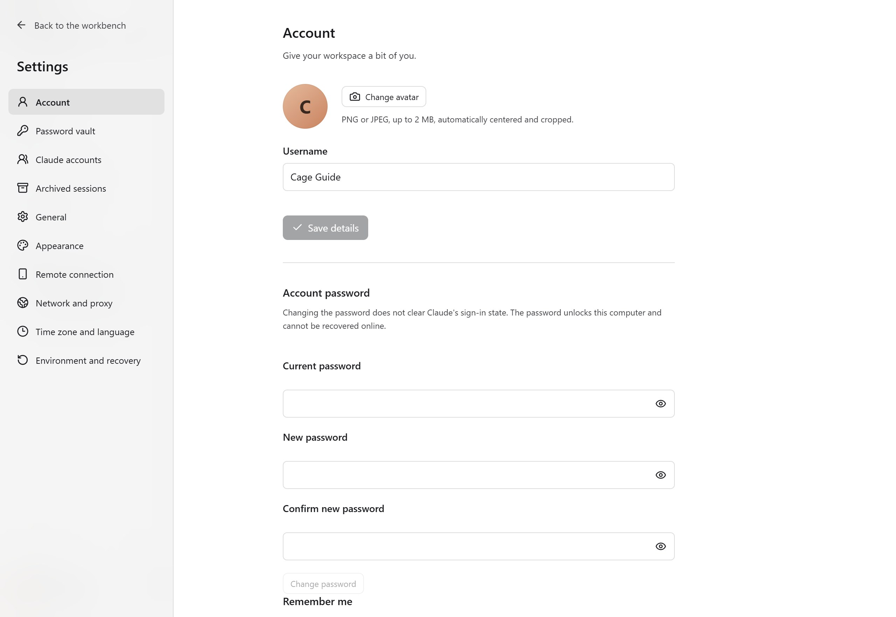
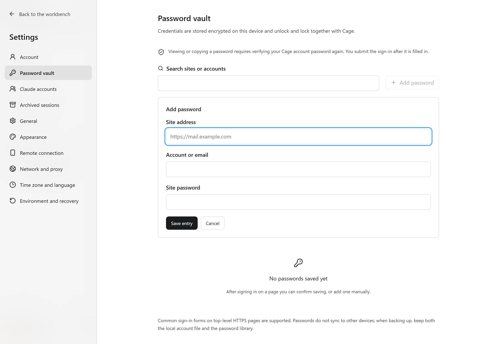
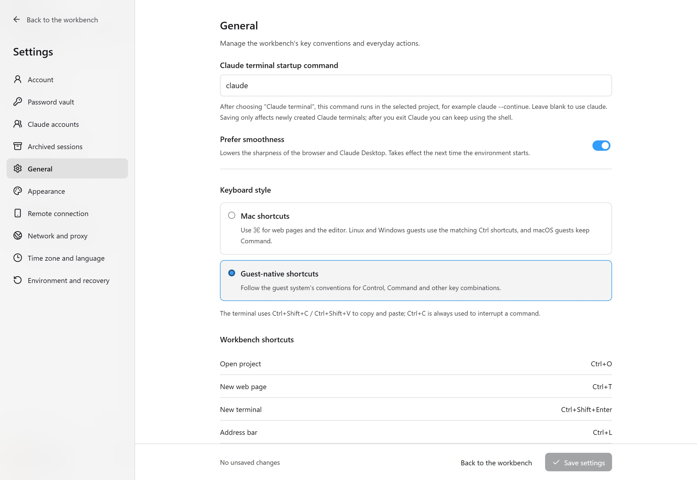
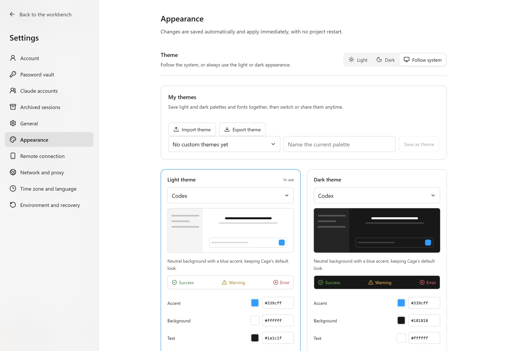

## Open settings and save

Click "Settings" in the avatar menu in the lower-left corner. Network and system configuration changes are applied with "Save settings" on the page. When a restart is needed, you are reminded to save your files first, because restarting ends terminal commands. Proxy nodes are applied separately with "Apply proxy".

Appearance changes take effect immediately and are saved automatically. If saving fails, click "Retry save". Keyboard and layout preferences on a remote client are saved on the current computer and do not change the server's runtime environment.

## Settings menu overview

| Entry | What you can set | When it takes effect |
| --- | --- | --- |
| Account | Avatar, username, password, remember sign-in and Touch ID where supported | Saved on the account page; verification is still needed after locking |
| Password vault | Website accounts, password records and save prompts | Takes effect after a record is changed; viewing or copying requires verification |
| Claude accounts | Sign in to multiple subscriptions, notes, check usage, include in scheduling | Assignment options affect new Claude terminals |
| General | Keyboard habits, Claude terminal startup command, default browser website, smooth image quality | Depends on the item: new terminals, new pages or the next environment start |
| Appearance | Light and dark theme, colors, font, font size, terminal and interaction preferences | Previewed immediately and saved automatically |
| Remote connection | Phone pairing for this computer, remote browser authorization, official or self-hosted relay | Takes effect after saving; relay migration requires pairing again |
| Network and proxy | Sources, nodes, proxy chains, DNS, exit rules and core diagnostics | Apply proxy or save; some changes need a restart |
| Time zone and language | Automatically follow the exit, or set the system and browser language manually | Apply, then restart as prompted |
| Environment and recovery | Storage, resources, component and tool versions, configuration recovery, diagnostics | For specific effects, see [Maintenance](maintenance.md) |

<figure class="guide-shot">
  
  <figcaption>Account profile, password and sign-in unlock settings. Screenshot version: 0.1.7-rc.1 (development build) · UI test stand on Windows 11 x64 · 2026-11-11. <a href="../../www/public/docs/screenshots/account-settings.jpg" target="_blank" rel="noopener">View original (2560 × 1764) ↗</a></figcaption>
</figure>

## Account and sign-in

The Cage account is only used to unlock the current environment, and there is no online recovery. Changes made in the cloud workbench apply to the server's account. Remember sign-in and Touch ID on macOS are bound to the system keychain. After you move the configuration directory, you may need to authorize again with the original password.

"Lock Cage" keeps background tasks running, while "Sign out" stops the environment. The account password is not the password that encrypts the project disk. Do not recreate the account to deal with updates or directory problems.

<figure class="guide-shot">
  
  <figcaption>Form for manually adding a website password. Screenshot version: 0.1.7-rc.1 (development build) · UI test stand on Windows 11 x64 · 2026-11-11. <a href="../../www/public/docs/screenshots/password-add.jpg" target="_blank" rel="noopener">View original (2560 × 1764) ↗</a></figcaption>
</figure>

## Password vault

After a website sign-in succeeds, choose to save or update. You can also add, search, edit and delete entries manually in the vault, and restore the save prompt for a website. After filling in, you submit the web form yourself. Viewing and copying passwords requires entering your Cage password again.

It currently supports common sign-in forms on top-level HTTPS pages. Embedded frames, CAPTCHAs, passkeys and the like are not handled automatically. Incognito pages do not show save prompts. If an older environment reports that it is unavailable, update the environment components first.

Password records are saved in the current host's Cage configuration and do not sync automatically across devices. The vault for a cloud instance is on the server. When backing up, keep the account file and the password vault together. When Cage is locked, the vault is locked too, and it can also be unlocked along with the sign-in when remember-sign-in unlock is used.

<figure class="guide-shot">
  
  <figcaption>Terminal startup command, image quality and shortcut settings. Screenshot version: 0.1.7-rc.1 (development build) · UI test stand on Windows 11 x64 · 2026-11-11. <a href="../../www/public/docs/screenshots/general-settings.jpg" target="_blank" rel="noopener">View original (2560 × 1764) ↗</a></figcaption>
</figure>

## General and keyboard

"Claude terminal startup command" applies to newly created Claude terminals, for example `claude --continue`. Saving does not change existing terminals. A custom command must be compatible with the CLI you installed.

"Keyboard habits" decide how the workbench and guest input are mapped. With a Debian guest, Mac mode maps common Command combinations in web pages and the editor to Linux controls. macOS and Windows guests use the keyboard behavior of their own systems. Terminal Ctrl+C still interrupts, and on Windows/Linux terminals, copy and paste use Ctrl+Shift+C/V.

"Default browser website" applies to web pages opened later. "Prefer smoothness" lowers drawing density to improve scrolling, and takes effect at the next environment start after saving. The browser's own tab layout and site data are managed in the separate browser settings.

<figure class="guide-shot">
  
  <figcaption>Light, dark and custom themes. Screenshot version: 0.1.7-rc.1 (development build) · UI test stand on Windows 11 x64 · 2026-11-11. <a href="../../www/public/docs/screenshots/appearance.jpg" target="_blank" rel="noopener">View original (2560 × 1764) ↗</a></figcaption>
</figure>

## Appearance, themes and accessibility

It can follow the system, or be fixed to light or dark. Presets include series for editors, reading and accessibility. Selecting a preset applies interface and terminal colors, keeps the font, and replaces current element color overrides.

Custom settings can adjust the accent color, background, text, sidebar, borders, buttons, focus, status, and the terminal ANSI palette. Fonts, font size, contrast, pointer and motion effects are also adjusted here. The colorblind-friendly blue-orange and high-contrast presets reduce reliance on telling red from green. Check the result together with status icons and text.

"My themes" can save as new, update or restore saved color schemes, up to 50. Import and export use `.cage-theme.json`, which does not include accounts, nodes, projects or local paths. Light/dark switching mode, font size and interaction preferences do not migrate with the theme file. The file limit is 256 KB. If the format is invalid, the current settings are kept.

When supported, you can "Sync from local Codex" to import appearance preferences, and Cage saves them independently after import. Web pages and editors in the virtual environment keep their own themes.

## Time zone, language and remote connection

Automatic time zone and language use the proxy exit for location lookup, and a manual choice is not replaced by the host location. Applying may restart the environment. For details, see [Time zone and exit rules](network.md#time-zone-language-and-exit-rules). On Linux guests, the "System time zone and locale" network check verifies, in addition to variables and configuration files, the actual UTC offset of the process and of the system time zone file. When `/etc/localtime` is a link, its target is verified too. If a file is missing or cannot be read, or the results are inconsistent, internet access stays off, and the check details explain the cause and the differences that were read.

Phone pairing in "Remote connection" applies to this computer's Cage. Switch back to this computer first, then generate a pairing code or remove a paired phone. SSH hosts are managed in the workbench sidebar. The phone relay and the cloud runtime environment are separate services. See [Phone connection](mobile.md) and [Cloud deployment](cloud.md) respectively.
