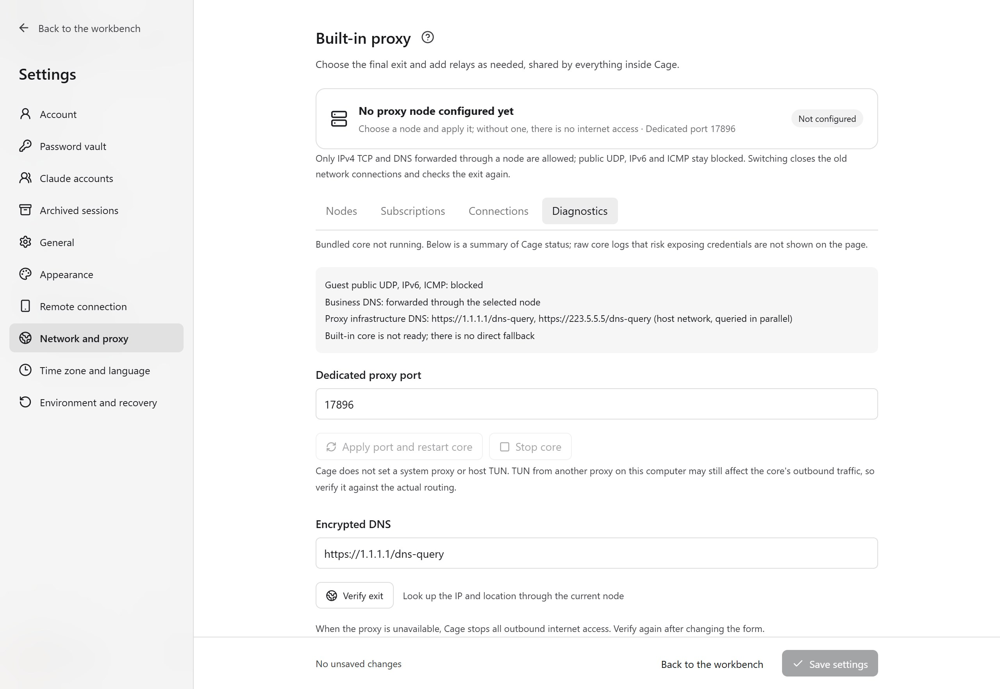
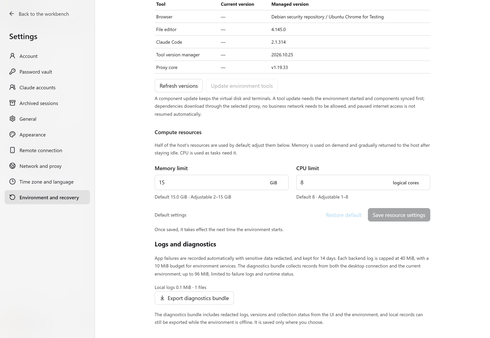

First check the current host, the Cage version and the exact error text. If the result of an operation is uncertain, read the latest status before deciding whether to retry. Do not use clearing the personal directory, deleting the virtual disk or rebuilding the account as routine troubleshooting steps.

An error first states the operation that failed, then the cause that can be confirmed right now. For example, "The upload window was closed" means you need to reopen the file window in the app. "Timed out waiting for a response" means you should check the connection first. "Not enough disk space" means you should first free up space on the disk that holds the environment. If you see "No recognizable cause was returned", keep the HTTP status or exit code shown in the message, open "Operation details", and export a diagnostics bundle from "Environment and recovery" in settings.

"Network check failed" lists the specific items and their results. "Not confirmed" means that enough results were not obtained. It is not treated as a passed check, and internet access stays off. Click "View checklist" next to the message to see the other items and suggested actions, without guessing which item is blocking the network.

## Download or install failed

| Symptom | What to do |
| --- | --- |
| GitHub 404 or no installer package | Choose your platform in the website download section, and confirm that the Release is public and the link is complete. A source ZIP cannot be used as an installer. |
| Mac says the app is damaged, cannot be verified or is unsupported | Check for Apple Silicon and macOS 14+, download the full DMG again, and check that version's signature, notarization and checksum notes. Keep the system's original message, and do not turn off system verification to hide the problem. |
| Windows unknown publisher | Confirm whether it is a preview clearly labeled as unsigned, and read the matching release notes. Do not treat it as a signed release. |
| Windows fails to start the virtual machine | Check virtualization in BIOS/UEFI and "Windows Hypervisor Platform", enable it, then restart. Keep the original WHPX error text for diagnosis. |
| Linux won't start | Confirm x86_64, a supported distribution and KVM permission, and use APT to install the missing dependencies. |
| Proxy core missing | Reinstall the complete app for the matching platform. Do not copy a single command-line file only. |

## Environment setup stuck or downloading repeatedly

Open "Operation details" to tell apart what is still downloading, what is installing dependencies, and what has already failed. After you check the node, the remaining disk space and the storage disk connection, click "Continue installation". If data is still arriving, you can wait. Files that fail the integrity check cannot be used.

| Error | Next step |
| --- | --- |
| `Download interrupted` / `partial data retained` | The incomplete file is kept. Fix the network and retry to resume. |
| `checksum mismatch` | The file digest does not match. Download it again, and do not skip the check. |
| `Guest DNS could not resolve` | Check the node and DNS settings, then retry after applying. |
| NodeSource / APT failure | Check the failing source and proxy access. Save the specific error and the diagnostics. |
| APT repeats `Tried to start delayed item` | Update to a build that includes the APT fix. If the older dependency manager fails to upgrade, fix the network first. Do not continue the dependency installation. |

When the Git pre-check fails, follow the prompt to update Git on this computer to 2.38+, check write permission for the global configuration, or check again. You do not need to reconfigure nodes. Enabling protection affects the host's global Git, so read the confirmation card first.

<figure class="guide-shot">
  <a href="../../www/public/docs/screenshots/proxy-diagnostics.jpg" target="_blank" rel="noopener" aria-label="View original: proxy core status and independent port diagnostics"></a>
  <figcaption>Proxy core status and independent port diagnostics. Screenshot version: 0.1.7-rc.1 (development build) · UI test stand on Windows 11 x64 · 2026-11-11. <a href="../../www/public/docs/screenshots/proxy-diagnostics.jpg" target="_blank" rel="noopener">View original (2560 × 1764) ↗</a></figcaption>
</figure>

## Node applied but no internet access

The critical check failure notice has a "View checklist" button beside it. Click it to see the failed items, and expand an item to see its detection evidence and suggested actions. The network status at the bottom also opens the same checklist. "Applied" only means the node was selected successfully. Internet access still needs the checks to pass.

| Status | What to do |
| --- | --- |
| Exit does not match the static IP, city or country rule | Switch back to a node that matches the original rule. If you really want to change the baseline, edit the IP rule explicitly. Rechecking does not accept a new IP automatically. |
| Matches a mainland China network range, or location is mainland China | Use a non-mainland exit. Static IP and "any region" cannot exempt it. If you suspect the attribution is wrong, keep the check report. |
| Proxy core not ready | Open proxy diagnostics to check the status, then reapply the node or restart the Cage core. |
| Port in use | Choose an unused independent Cage port and restart as prompted. There is no need to stop other proxies. |
| Location lookup failed | Retry or switch nodes. In every mode, confirm a non-mainland exit. A manual time zone and language setting does not skip the country or region check. |
| Exit sampling is incomplete | Expand the evidence to see whether the host, the virtual machine terminal or the browser is missing, and whether it was a timeout or an HTTP status. A passing terminal proxy check still needs the other paths to succeed. The dynamic IP rule cannot replace missing samples. |
| Manually paused or report expired | Check again after confirming. Internet access resumes only when all critical items pass. |
| "Check or monitoring authorization expired" keeps appearing | See the renewal troubleshooting below, record when it happens and when it recovers, and export a diagnostics bundle. |
| Offline after the host switches networks | Wait for recovery and a full recheck. A manual pause is not lifted automatically. |

Being able to reach the internet in your local browser does not prove that the Cage proxy is configured. If a subscription has no nodes, check whether it is YAML containing `proxies` / `payload`. Do not upload a private subscription to an online conversion site or to an Issue.

### Network permission keeps expiring

"Check or monitoring authorization expired" means Cage could not finish renewing before the short-term permission ran out, so the environment turns internet access off. Even when the node can still reach websites, expiry can happen because checks were waiting in the schedule or running too slowly. If proxy errors also appear in the logs, check the node as well.

First look at the checklist and "Operation details", and record when it went offline, when the full recheck started, and when it recovered. An environment that was not paused manually tries a full recheck, and the network status shows the wait time or the reason. A manual pause must be resumed manually. Security monitoring runs independently of the lifecycle operation lock, but a full recheck still waits for the current operation to finish. If it keeps happening, export a diagnostics bundle from settings after you reproduce the problem. Maintainers can use it to tell apart waiting for the operation lock, NIC queries, proxy checks, environment verification, renewal requests and recovery waits. While waiting for recovery, saved files and offline terminals remain usable.

The diagnostic logs in the current source record the time and errors of each exit query, using the fixed service identifiers `icanhazip` and `ipify`, and these identifiers are kept on export. The `logs/`, `safety/latest-report.json` and `manifest.json` in the diagnostics bundle can help locate the failed stage. Check the sanitization result before you share. Older installers may lack staged diagnostics or timeout retries, so include the app version as well. Do not judge the behavior of an installed version from the source code alone.

## Task exits with 137 or network drops after a heavy task

137 means the process was forcibly killed, and it cannot independently prove an OOM. Go to "Settings → Environment and recovery → Compute resources" to check the OOM count, the limit and the usage after the environment starts, then export the logs. An increasing OOM count means the guest once killed a process because it ran out of memory. Use the logs to identify the specific process.

If the old environment's limit is low, save your work, then restart the app with the saved resource settings. If you reach the limit, reduce the number of parallel compile, render or other tasks. Heavy tasks can also make checks time out and trigger internet shutdown, and recovery must pass a full recheck.

## Original account and data seem to be gone

If the create-account screen appears again, the current configuration directory usually cannot find the original account. Check the default `.claude-cage`, an explicit `CLAUDE_CAGE_CONFIG`, the original environment storage, and the current local or SSH host. Keep the current state first, do not create a new account, and do not copy only `account.json`.

The original directory must be kept together with bookmarks, the password vault, the configuration and the persistent disk. Before migrating, stop the related background services, make a full backup, and then restore the same set of data. If quick sign-in is bound to the original directory, unlock with the original password after migrating and authorize again. If the system keychain is temporarily unavailable, use the password and click "Check quick sign-in again".

## Claude sign-in and account problems

Existing sign-ins on the host are not imported automatically. Complete the official authorization in a Claude terminal inside Cage, then verify the identity in the accounts panel and click "Add to scheduling". Web, Desktop and CLI sign-ins are managed separately.

When "No account available for assignment" appears, check whether the sign-in is valid, whether the account is included in automatic assignment, and the usage limit and reset time, then click "Check status". After a regular terminal switches identity, the new account must be added again. When a usage reading is missing or too old, do not treat the old percentage as a live guarantee.

If the model still rejects requests, record the official error type, and check the usage eligibility and the critical network checks. Being able to open the authorization page only shows that the web page is reachable. Success is confirmed only after authorization is complete and one real request succeeds.

When the history list shows "Could not read", sessions already read are kept, and the active markers are cleared temporarily. Click the retry button and wait for reading to finish. On Windows, prompts distinguish configuration, pairing verification, connection, communication and request timeouts. Only explicit desktop status errors require signing in again or unlocking the guest. Do not sign in to Claude again just because reading failed. If failures persist, copy the full reason and export a diagnostics bundle.

When an account handover is blocked, first deal with unfinished tools, approvals, pending messages and background tasks, then check the resume group, the target sign-in and the usage limit. After a failed handover, retry the original operation, or cancel during preparation. Do not resend old messages to restore history. For detailed authorization conditions, see [Switch accounts within the same session](accounts.md#switch-accounts-within-the-same-session).

## Browser, Desktop or file upload problems

If the browser shows a white screen or is waiting to be restored, click "Restore browser". If the whole interface stops, reopen the app. On an error page, you can click "Reload interface" or export diagnostics. Start `localhost` services inside Cage.

If the Desktop picture has the wrong proportions, first set "Display size" to 100%, then click "Retry resizing". After updating components, save your work, then close and reopen Desktop. If uploads still show an internal directory or "The file picker didn’t open", sync the components first in the same way, then reopen the app.

When the Desktop file service exits or the connection breaks, Cage tells you the reason and lowers the retry frequency. After recovery, it resumes reading file requests automatically. If it keeps reporting that the service exited, reopen Desktop and check the app's exit reason in the resource settings and diagnostics log.

When a shared project shows Git file owner errors, update Cage and reconnect the project. The new connection shows files using the user ID inside the environment. If a Git remote operation shows host key or authentication errors, complete the matching Git authentication and host identity verification in the guest.

After clearing all cookies in a regular session, editor authentication becomes invalid. Click "Restore editor". If the password, extension or cookie entries are unavailable, check the app and environment component versions. If a website rejects attachments, also check its own format and size limits.

## Phone pairing and session problems

| Symptom | What to do |
| --- | --- |
| QR code invalid | Switch the computer back to this computer, unlock Cage, and refresh the QR code. If the camera is unavailable, use a one-time pairing code. |
| Connected but no projects | Open the project explicitly in Cage on the computer, start the environment, then read again. |
| Computer is locked | Unlock the computer, then read the phone sessions again. |
| Phone says to enable the browser or Claude Desktop in the computer's settings | Run a computer build that supports direct access after pairing, quit the old version and reopen Cage, then reconnect with the original pairing. A phone that uses a command-line connection file needs to switch to the QR code or pairing code generated by Cage on the computer. |
| Network drops while sending or approving | After the connection is restored, read the history and pending approvals first, check the result, then act. |
| Identity changed, or only the current turn can be verified | Do not keep sending old history. Start a new session as prompted. |
| Cannot connect after changing the relay | Save the same address on both ends, revoke the old pairing, then register again. |

Simulator previews cannot prove that a real connection works. A phone only resumes sessions whose original account and project can be verified. Existing history in authorized projects can enter the list according to the [session scope](mobile.md#create-sessions-and-handle-tool-approvals). Phones already support Claude Desktop control, but the full flow for the native official Windows app still needs verification. If the entry is unavailable, check the computer and guest component versions.

## Tailscale sign-in or SSH failure

First confirm that the Cage environment has started and passed the network check, that the components are installed, and that Tailscale on this computer and Cage have joined the same private network. The sign-in page opens in the Cage browser. Networks that require device approval also need an administrator to approve.

When this computer connects to Cage, check that the public key has been added to the panel, use the actual guest username and address shown in the panel, and check the private-network access rules. When Cage connects to this computer, this computer must also have the SSH service enabled and allow authentication. Tailscale sign-in does not automatically grant SSH access on this computer. Do not paste a private key into the public key field.

Pausing internet access, a proxy interruption or stopping the environment affects private-network connections. "Disconnect" keeps the identity and public keys, and "Sign out" requires reauthorization next time. Verification of real account authorization and a full connection in the installed environment is still pending. For the current scope, see the [Tailscale guide](tailscale.md).

## SSH or cloud deployment failure

First confirm the SSH address, port, user, authentication method and server network. When the host fingerprint changes, verify it separately instead of accepting an unknown identity directly. If the first deployment fails, check the Linux x86_64, cgroup v2, systemd user service, UID/GID mapping and FUSE/TUN prerequisites.

If the service exited, reconnecting can try to start it. If it keeps failing, check the user service logs. Closing the local app does not stop the remote side. If you want to stop tasks, stop the environment in the matching server workbench. If the service stops when nobody is logged in, the administrator should check linger. Restoring the service after a server reboot must be configured and verified separately.

Do not repair the deployment by deleting containers, the engine data-root or accounts. If the connection breaks, first check whether the operation completed, then retry actions that have a write effect.

<figure class="guide-shot">
  <a href="../../www/public/docs/screenshots/resources-diagnostics.jpg" target="_blank" rel="noopener" aria-label="View original: automatic resource limits and diagnostics export entry"></a>
  <figcaption>Automatic resource limits and diagnostics export entry. Screenshot version: 0.1.7-rc.1 (development build) · UI test stand on Windows 11 x64 · 2026-11-11. <a href="../../www/public/docs/screenshots/resources-diagnostics.jpg" target="_blank" rel="noopener">View original (2560 × 1764) ↗</a></figcaption>
</figure>

## Export diagnostics and feedback

Export a ZIP from the log diagnostics under "Settings → Environment and recovery". Cloud exports require the connection to stay open. If the interface will not open, use the Cage command included in the installer:

```sh
cage diagnostics --json /absolute/path/cage-diagnostics.zip
```

The macOS command is at `Cage.app/Contents/Resources/cage`, the Windows command is at `resources\cage.exe` in the install directory, and the Linux command is in the application directory. Use an absolute output path on this computer. Local logs can still be exported when the control service is unavailable.

When reporting to [GitHub Issues](https://github.com/Lee-xeo/Claude-Cage/issues), include the app version, operating system, processor architecture, current mode, reproduction steps, expected result and the exact error text. Before sharing, check the diagnostics and screenshots, and hide account names, IPs, paths, proxy credentials and authorization links. Do not upload the whole configuration directory, the full subscription or project content.
