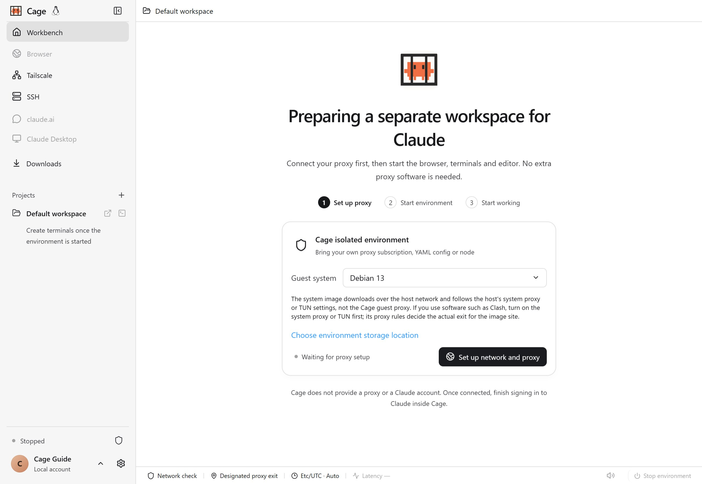

## Open projects and edit files

Terminals and tools run in the guest system you chose. macOS uses the Mac toolchain, Windows uses PowerShell and Windows tools, and Debian uses Linux tools. The browser, editor and Claude Desktop all open from the same workbench. For system combinations and install methods, see [Choose a guest system](guest-systems.md).

Click the plus next to "Projects" in the left sidebar to select an existing project, or click "Add a local project..." to open a host directory. You can also use the default workspace without a project. The project list is saved and stays available the next time you start.

In the project selection window, select an added directory and click "Remove this project from Cage", then confirm to end sharing and remove it from the list. Save your files and close this project's terminals, running sessions and editor first. The original files and session history are kept, and adding the same directory again lets you continue using the history. After you remove the current project, the default workspace is selected, and it is always kept. You can also open the project selection window to remove a directory while the environment is stopped.

The open icon (↗) next to a project edits that directory in code-server, and the terminal icon (>_) selects the terminal type. Files are written directly to the shared directory, so back up important projects first. The `.git` inside a project is readable and writable, so you can stage, commit and switch branches directly in Cage.

All projects share one environment, tools and accounts. Switching projects does not change the directory of existing terminals, close web pages or revoke earlier sharing. For cloud directories and permissions, see [Cloud deployment and SSH](cloud.md).

Shared files appear as owned by the current user inside the environment, and Git can read the status and history of the open project normally. File contents still belong to the original host directory. Git metadata is shared with the project, and Git operations in the environment update the host repository directly. Hidden files, tool configuration, Git configuration and hooks inside the authorized directory are shared as ordinary project files. Cage does not hide extra files or block writes by filename. Read-only authorization for a whole directory shared from the cloud still applies.

<figure class="guide-shot">
  
  <figcaption>Workbench sidebar, default project and terminal entry (environment not started). Screenshot version: 0.1.6-alpha-preview (development build) · macOS native app · 2026-11-07. <a href="../../www/public/docs/screenshots/first-start.jpg" target="_blank" rel="noopener">View original (2560 × 1764) ↗</a></figcaption>
</figure>

## Start a new Claude terminal

1. Click the terminal icon next to a project and choose "New Claude terminal". Cage starts `claude` in that directory.
2. The first time you use it, sign in following the official prompts. The authorization page is completed in the Cage browser. Claude sign-ins already on the host are not imported automatically.
3. If you have several subscriptions, register them first following [Multiple accounts and usage limits](accounts.md). The new Claude terminal tab shows the assigned account.

Claude Code tabs use an agent icon. When numbered, the number shows the account the session is bound to. Regular terminals keep the terminal icon. Account assignment and resuming across accounts are managed in [Account settings](accounts.md#switch-accounts-within-the-same-session). The icon itself does not switch identity.

Cage's shared Claude sessions first show "Preparing the Claude session…", check the startup prompts of their own channel in the background, and then show the session screen. To see sign-in or troubleshooting information, click "Show startup progress". If preparation takes more than 8 seconds, the terminal is shown automatically so a stuck prompt is not hidden. Regular terminals still show output directly.

You can also create a regular terminal and run shell commands yourself. Add arguments under "Settings → General → Claude terminal startup command", for example `claude --continue`. This only applies to Claude terminals created later. The shell remains usable after you exit Claude.

Structured sessions on mobile and regular terminals are managed separately. See [Mobile session scope](mobile.md#create-sessions-and-handle-tool-approvals) for details.

When the history list shows a read failure, the history already displayed stays, and old active markers are cleared. Click the retry button to check the latest status. The button is disabled while reading, but the reason can still be copied. If failures persist, check the environment connection and diagnostics following [Session read failures](troubleshooting.md#claude-sign-in-and-account-problems).

## Manage tabs and split view

Hover over a terminal row or focus it with the keyboard to pin, rename or delete it. For web tabs, right-click or press Shift+F10 to open the menu. Drag to reorder within the same list, press Esc to cancel dragging, and refreshing keeps the order. When there are many pages, use the down arrow to search open web pages.

The workbench supports combining web pages and terminals. Regular web pages also support two-page split view. Incognito pages can be split with a terminal, but two-page split view only supports regular tabs. The × at the upper right of the browser returns you to the previous workspace, and open pages and sign-in state are kept.

On macOS, `⌘1–9` switches between web pages and terminals in the current directory. On Windows and Linux, use Ctrl in the workbench. Ctrl+C in a terminal always interrupts the command.

## Uploads, downloads and attachments

When you choose files to upload on a web page, "Upload local files" is shown. Click "Choose local file" to open the system window. Up to 100 files at a time, each up to 2 GB; websites may have smaller limits. Only the files you select are passed, and the whole folder is not shared. If you cancel, refresh or close the original page, you need to select the files again.

You can drag images, videos or documents onto a target that accepts attachments, or copy them in the file manager and paste into Cage. The terminal saves attachments to a guest directory and inserts a quoted path for Claude Code to read. It does not run them automatically. Pasted screenshots are limited to 20 MB and 40 million pixels. File transfers do not use external storage as a relay.

Downloads are completed inside the Cage environment. In local mode, the complete file is first kept in the default workspace `Downloads`, with automatic renaming for duplicate names. After the workbench sees that the download is complete, a "Save as" dialog appears. Cancelling keeps the file at the default location. The "Downloads" item on the left or the browser download button shows progress, opens files, shows file locations, or saves them elsewhere.

Cloud files and copies already saved to this computer are recorded separately. To open a remote file in another app, first save it to this computer explicitly.

## Input methods and clipboard

Click the target input first, then copy or paste. In macOS terminals, use `⌘C/V`; in Windows/Linux terminals, use `Ctrl+Shift+C/V`. Claude terminals in the Cage desktop app also support `Ctrl+V` to paste a screenshot or text from the local clipboard. Images are saved to the guest and inserted as a path Claude Code can read. Pressing Enter before the transfer completes waits; if the transfer fails, the pending send is cancelled. Regular web pages, the editor and local input fields follow your chosen keyboard habits, which you can adjust under "Settings → General".

Selections managed by Claude Code itself and text copied with `/copy` are written to the local clipboard and take part in the existing shared-clipboard sync. When a terminal reconnects, it only restores the history screen and does not run old copies again. When a terminal program takes over the mouse, you can also hold Option and drag on a Mac, or hold Shift and drag on Windows/Linux, then copy. Ctrl+C keeps its terminal interrupt behavior. If a regular browser cannot use the clipboard because of permission limits, use the "Text transfer" panel to pass plain text.

When the Cage desktop app runs a Linux guest, this computer, the Cage browser and Claude Desktop share the clipboard for text, images, files and folders in both directions. After you click a copy button in the app, you can paste the content on the other side. Sharing continues when you switch views or the window loses focus. Dragging to select text only changes the selection, and the shared content is updated after you copy. For scope, size limits and file retention rules, see [Claude Desktop: Copy and paste](desktop.md#copy-and-paste).

The copy button in the regular web workbench can sync plain text to this computer. Keep the web page and window in front and wait for "Copied to this computer". Switching tabs or input positions may cancel a transfer that has not finished. Just copy again.

## Close, lock and sign out

| Action | Effect on tasks |
| --- | --- |
| Close or hide the window | The environment, terminals, web pages and downloads keep running. While hidden, the screen display is paused, and it reconnects when you return. |
| Lock Cage | Hides the workbench and requires verification. Running tasks continue. Protected actions on the phone are paused. |
| Quit the app and keep the environment | Background tasks continue, and they reconnect when you open the app again. |
| Stop the environment or sign out of the account | Ends running terminals. Projects, disk and sign-in data are kept. |
| Refresh the workbench | Lets you reconnect to terminals still alive in the background. |
| Restart the control service or environment | Old terminal processes cannot be restored and need to be created again. |

Save editor contents before stopping. Files and Claude history saved on disk do not mean that ended processes and temporary terminal output can be recovered.
