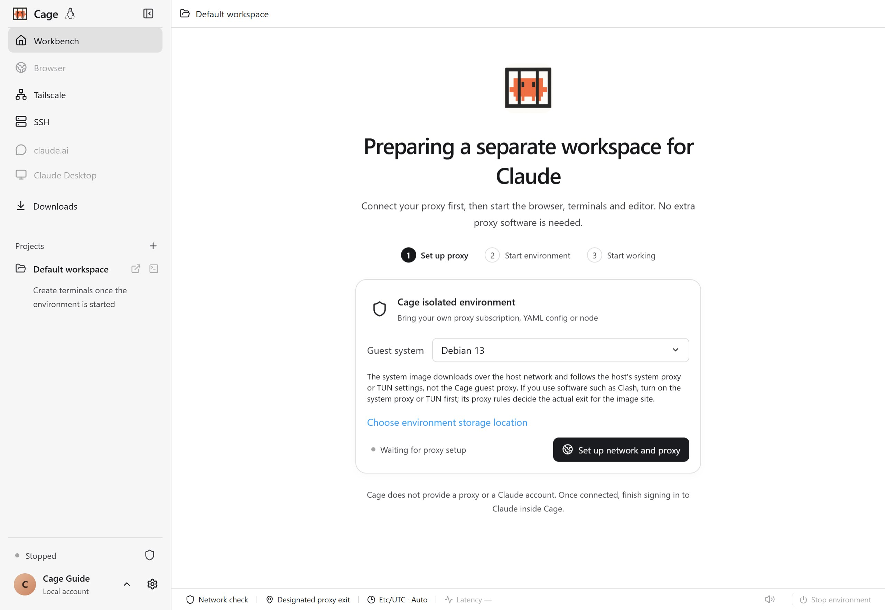

## Open projects and edit files

Terminals and tools run in the guest system you chose. macOS uses the Mac toolchain, Windows uses PowerShell and Windows tools, and Debian uses Linux tools. The browser, editor and Claude Desktop all open from the same workbench. For system combinations and install methods, see [Choose a guest system](guest-systems.md).

点击左侧“项目”旁的加号，选择已有项目，或点“添加本机项目…”创建项目。填写项目名称，连续添加需要一起使用的文件夹，再点击“创建项目”。例如“课程系统”可同时绑定前端与后端目录。项目名称和绑定关系会保存，下次启动继续可用。没有项目时可以使用浏览器与 Claude Desktop；终端和文件编辑器需先添加项目。

第一个文件夹是默认工作目录。新建终端与 Claude 会话从默认文件夹启动，Claude 同时获得其余绑定文件夹的读写权限。不同文件夹的 Git 仓库仍分别管理，修改和删除会直接影响本机原文件，请使用版本控制或备份。项目内的 `.git` 可读写，可直接在 Cage 中暂存、提交和切换分支。

在项目选择窗口选中项目，点击“编辑名称与文件夹…”可重命名、添加或解绑文件夹。默认文件夹用于关联已有会话历史，需保留。修改绑定后，新建或重新打开 Claude 会话生效；解绑前请保存文件，关闭整个项目的终端、运行中会话和编辑器。文件夹解绑只解除共享，原文件与历史保留。

Linux 环境默认缓存项目文件的名称与属性，减少每次读取都要与本机往返的开销。代价是你在本机上直接修改、删除或追加的文件，环境最多 20 秒后才看到；环境内所做的改动始终立即可见。刚在本机改过文件、需要环境马上看到时，点击“项目”旁加号左边的“刷新项目文件”。正被某个程序打开着的文件仍要等缓存到期。经常在本机和环境里同时编辑同一批文件时，可以在“设置 → 通用”关闭“项目文件缓存”，下次启动环境后每次读取都直接访问本机。macOS 与 Windows 环境始终直接读取，没有这个按钮和设置。

项目旁的打开图标（↗）在 code-server 中编辑默认文件夹。多文件夹项目展开后，每个文件夹还有单独的编辑器入口。终端图标（>_）用于选择终端类型，项目内各文件夹已有的会话集中显示在项目下。手机上的项目名称、会话分组和新建会话使用相同绑定关系。

在项目选择窗口选中项目，点击“从 Cage 移除此项目”并确认，可解除全部绑定文件夹的共享并从列表移除。请先保存文件并关闭该项目的终端、运行中会话和编辑器。原文件与会话历史保留，重新添加相同默认目录后可继续使用历史。移除当前项目后选中剩余项目；移除最后一个项目后，项目列表为空。环境停止时也可移除项目。

已有的单文件夹项目可直接编辑并添加更多文件夹。临时共享给云端的本机项目仍通过“共享本机项目…”单独授权，断开连接后结束共享。

All projects share one environment, tools and accounts. Switching projects does not change the directory of existing terminals, close web pages or revoke earlier sharing. For cloud directories and permissions, see [Cloud deployment and SSH](cloud.md).

Shared files appear as owned by the current user inside the environment, and Git can read the status and history of the open project normally. File contents still belong to the original host directory. Git metadata is shared with the project, and Git operations in the environment update the host repository directly. Hidden files, tool configuration, Git configuration and hooks inside the authorized directory are shared as ordinary project files. Cage does not hide extra files or block writes by filename. Read-only authorization for a whole directory shared from the cloud still applies.

<figure class="guide-shot">
  <a href="../../www/public/docs/screenshots/first-start.jpg" target="_blank" rel="noopener"></a>
  <figcaption>Workbench sidebar, default project and terminal entry (environment not started). Screenshot version: 0.1.7-rc.1 (development build) · UI test stand on Windows 11 x64 · 2026-11-11. <a href="../../www/public/docs/screenshots/first-start.jpg" target="_blank" rel="noopener">View original (2560 × 1764) ↗</a></figcaption>
</figure>

## Git commits and GitHub sign-in

Git can stage, commit and switch branches in shared writable projects. Before your first commit, check the committer details in a regular Cage terminal. If nothing is configured, enter the name and email you want to appear in the commit history. A GitHub privacy email also works.

```sh
git config --global --get user.name
git config --global --get user.email
git config --global user.name "Your committer name"
git config --global user.email "Your committer email"
```

The global settings apply to every project in the current environment. When a single project needs a different identity, use `--local` instead of `--global` in the project directory. Local settings that a repository already has take priority. If commits must be signed with GPG or SSH, set up the signing tool and keys separately inside the environment.

Pushing to private repositories, managing PRs or closing issues also needs GitHub authorization. GitHub CLI (`gh`) is installed with the environment tools. If an older environment says the command is not found, update the environment tools under "Settings → Environment and recovery → Versions and components" first, then open a new regular terminal. macOS, Windows and Linux use the same sign-in commands:

```sh
gh auth login --hostname github.com --git-protocol https --web
gh auth setup-git --hostname github.com
gh auth status --hostname github.com
```

Follow the terminal prompt to open the GitHub authorization page, enter the one-time code and confirm the authorization yourself. If the browser does not open automatically, you can also visit the address shown in the terminal by hand. `gh auth setup-git` makes HTTPS Git operations use this sign-in. For details, see the [GitHub sign-in notes](https://cli.github.com/manual/gh_auth_login) and the [Git credential setup notes](https://cli.github.com/manual/gh_auth_setup-git).

The sign-in is saved in the current environment and survives restarts and updates. Sign-ins in Chrome on this computer, SSH private keys and Git credentials are not imported automatically. `gh` prefers the system credential store and, when that is unavailable, saves to a configuration file inside the environment. Use `gh auth status` to see where it is stored. Browser sign-in and command-line authorization are managed separately.

After signing in, check the project's remote address. HTTPS authorization does not authenticate SSH addresses. If `origin` still uses `git@github.com:…`, you can switch it to HTTPS after confirming the repository address:

```sh
git remote -v
git remote set-url origin https://github.com/OWNER/REPOSITORY.git
git push
```

The signed-in account still needs write access to the target repository. Organization SSO, branch protection and workflow permissions are still managed by GitHub.

## Start a new Claude terminal

1. 点击项目旁的终端图标，选“新建 Claude 终端”。Cage 会在默认文件夹启动 `claude`，并让它访问项目内其余绑定文件夹。
2. The first time you use it, sign in following the official prompts. The authorization page is completed in the Cage browser. Claude sign-ins already on the host are not imported automatically.
3. If you have several subscriptions, register them first following [Multiple accounts and usage limits](accounts.md). The new Claude terminal tab shows the assigned account.

Claude Code tabs use an agent icon. When numbered, the number shows the account the session is bound to. Regular terminals keep the terminal icon. Account assignment and resuming across accounts are managed in [Account settings](accounts.md#switch-accounts-within-the-same-session). The icon itself does not switch identity.

Cage's shared Claude sessions first show "Preparing the Claude session…", check the startup prompts of their own channel in the background, and then show the session screen. To see sign-in or troubleshooting information, click "Show startup progress". If preparation takes more than 8 seconds, the terminal is shown automatically so a stuck prompt is not hidden. Regular terminals still show output directly.

You can also create a regular terminal and run shell commands yourself. Add arguments under "Settings → General → Claude terminal startup command", for example `claude --continue`. This only applies to Claude terminals created later. The shell remains usable after you exit Claude.

Structured sessions on mobile and regular terminals are managed separately. See [Mobile session scope](mobile.md#create-sessions-and-handle-tool-approvals) for details.

When the history list shows a read failure, the history already displayed stays, and old active markers are cleared. Click the retry button to check the latest status. The button is disabled while reading, but the reason can still be copied. If failures persist, check the environment connection and diagnostics following [Session read failures](troubleshooting.md#claude-sign-in-and-account-problems).

## Manage tabs and split view

Hover over a terminal row or focus it with the keyboard to pin, rename or delete it. For web tabs, right-click or press Shift+F10 to open the menu. Drag to reorder within the same list, press Esc to cancel dragging, and refreshing keeps the order. When there are many pages, use the down arrow to search open web pages.

The workbench supports combining web pages and terminals. Regular web pages also support two-page split view. Incognito pages can be split with a terminal, but two-page split view only supports regular tabs. The × at the upper right of the browser returns you to the previous workspace, and open pages and sign-in state are kept.

On macOS, `⌘1–9` switches between web pages and terminals in the current directory. On Windows and Linux, use Ctrl in the workbench. Ctrl+C in a terminal always interrupts the command.

## Uploads, downloads and attachments

When you choose files to upload on a web page, "Upload local files" is shown. Click "Choose local file" to open the system window. Up to 100 files at a time, each up to 2 GB; websites may have smaller limits. Only the files you select are passed, and the whole folder is not shared. If you cancel, refresh or close the original page, you need to select the files again.

You can drag images, videos or documents onto a target that accepts attachments, or copy them in the file manager and paste into Cage. The terminal saves attachments to a guest directory and inserts a quoted path for Claude Code to read. It does not run them automatically. Pasted screenshots are limited to 20 MB and 40 million pixels. File transfers do not use external storage as a relay.

下载在 Cage 环境内完成。本机模式的完整文件先保留在下载暂存目录，同名自动换名；工作台观察到完成后弹出“另存为”。取消仍保留默认位置的文件。在左侧“下载”或浏览器下载按钮可查看进度、打开、显示文件位置或另存。

Cloud files and copies already saved to this computer are recorded separately. To open a remote file in another app, first save it to this computer explicitly.

## Input methods and clipboard

Click the target input first, then copy or paste. In macOS terminals, use `⌘C/V`; in Windows/Linux terminals, use `Ctrl+Shift+C/V`. Claude terminals in the Cage desktop app also support `Ctrl+V` to paste a screenshot or text from the local clipboard. Images are saved to the guest and inserted as a path Claude Code can read. Pressing Enter before the transfer completes waits; if the transfer fails, the pending send is cancelled. Regular web pages, the editor and local input fields follow your chosen keyboard habits, which you can adjust under "Settings → General".

Selections managed by Claude Code itself and text copied with `/copy` are written to the local clipboard and take part in the existing shared-clipboard sync. When a terminal reconnects, it only restores the history screen and does not run old copies again. When a terminal program takes over the mouse, you can also hold Option and drag on a Mac, or hold Shift and drag on Windows/Linux, then copy. Ctrl+C keeps its terminal interrupt behavior. If a regular browser cannot use the clipboard because of permission limits, use the "Text transfer" panel to pass plain text.

When the Cage desktop app runs a Linux guest, this computer, the Cage browser and Claude Desktop share the clipboard for text, images, files and folders in both directions. After you click a copy button in the app, you can paste the content on the other side. Sharing continues when you switch views or the window loses focus. Dragging to select text only changes the selection, and the shared content is updated after you copy. For scope, size limits and file retention rules, see [Claude Desktop: Copy and paste](desktop.md#copy-and-paste).

The copy button in the regular web workbench can sync plain text to this computer. Keep the web page and window in front and wait for "Copied to this computer". Switching tabs or input positions may cancel a transfer that has not finished. Just copy again.

## Close, lock and sign out

| Action | Effect on tasks |
| --- | --- |
| Close or hide the window | The environment, terminals, web pages and downloads keep running. While hidden, the screen display is paused, and it reconnects when you return. |
| Lock Cage | Hides the workbench and requires verification. Running tasks continue. Protected actions on the phone are paused. |
| Quit the app and keep the environment | Background tasks continue, and they reconnect when you open the app again. |
| Stop the environment or sign out of the account | Ends running terminals. Projects, disk and sign-in data are kept. |
| Refresh the workbench | Lets you reconnect to terminals still alive in the background. |
| Restart the control service or environment | Old terminal processes cannot be restored and need to be created again. |

Save editor contents before stopping. Files and Claude history saved on disk do not mean that ended processes and temporary terminal output can be recovered.
